<div align="center">


# CurSimple · 课简

**Timetables, notes, reminders and independent components for your whole semester.**

An open-source, free Android timetable app without ads. Import courses with school plugins, connect learning platforms and notification services with components, and manage courses, events and tasks on your phone and home screen.

[](https://github.com/cursimple/cursimple-app/actions/workflows/android-ci.yml)
[](https://github.com/cursimple/cursimple-app/releases/tag/v0.7.10)
[](https://github.com/cursimple/cursimple-app/releases)
[](LICENSE)
[](https://developer.android.com)

[Website](https://cursimple.github.io/cursimple-app/) · [Download](https://github.com/cursimple/cursimple-app/releases) · [Plugin catalog](https://cursimple.github.io/cursimple-plugins/) · [Component catalog](https://cursimple.github.io/cursimple-components/) · [简体中文](README.md)

</div>

The current release channel is **beta / Pre-release**. This README describes the current code; locally added features are still being tested. Check each Release announcement for the capabilities of its published APK.

## How CurSimple fits together

| Part | Purpose | Links |
|---|---|---|
| CurSimple app | Timetables, course notes, events, reminders, backups and home screen widgets | [Download the app](https://github.com/cursimple/cursimple-app/releases) |
| School import plugins | Sign in to a school's academic system and import courses; each school adapter updates independently | [Plugin catalog](https://cursimple.github.io/cursimple-plugins/) · [Registry](https://github.com/cursimple/cursimple-plugins) |
| Extension components | Sync learning tasks and announcements, connect notification services, and provide their own pages and declared widgets | [Component catalog](https://cursimple.github.io/cursimple-components/) · [Registry](https://github.com/cursimple/cursimple-components) |

Home screen widgets display courses, notes or component content. Components are installed and enabled as needed; components that declare widgets expose their own entries, which disappear when disabled or removed.

## Download and get started

Choose an APK from [Releases](https://github.com/cursimple/cursimple-app/releases) or the [website download section](https://cursimple.github.io/cursimple-app/#download). Enable the beta update channel to receive test releases. The channel and GitHub Pre-release flag determine whether a build is a beta.

| APK | Device |
|---|---|
| `CurSimple-arm64-v8a.apk` | Common 64-bit ARM phones |
| `CurSimple-armeabi-v7a.apk` | Older 32-bit ARM devices |
| `CurSimple-x86_64.apk` / `CurSimple-x86.apk` | Matching Intel devices or emulators |
| `CurSimple-universal.apk` | Universal package when unsure |

1. Set your semester and starting date.
2. Install a school plugin from the Plugins market, sign in and sync. Manual entry, timetable codes, QR scanning and AI screenshot import are also available.
3. Keep course notes and tasks in Notes, and add personal events to the timetable.
4. Configure class notices and alarms, then check notification, exact-alarm and background permissions.
5. Install any components you need, sign in or bind notification recipients, and add widgets to your home screen.

## Features

### Timetables and events

- **Week and day views:** merged multi-period courses, odd/even/custom weeks, exams, cancellations and rescheduling.
- **Today overview:** current and next class, countdowns, a full-day timeline and conflict details.
- **Real-time events:** meetings, clubs and personal events use actual start/end times and appear beside overlapping classes or in folded groups.
- **Course editing:** long-press to reschedule or add another course at the same day and period; teachers and rooms can vary by week.
- **Appearance and zoom:** customize text, colours, cards, grids and background images, with pinch zoom and panning.
- **Semesters:** independent timetables, daily schedules and week counts; holiday, make-up day and temporary overrides.

### Course notes and memos

| Capability | What it does |
|---|---|
| Course notebooks | Course-specific and general notes; search titles, full text, course information and completed notes |
| Tasks | Checklists, priorities, pins, deadlines and completion; filter due-today and overdue items |
| Read safely | Saved notes open read-only; enter edit mode explicitly and confirm changes or discarded drafts |
| Images | Insert local images, open thumbnails for zoom and panning; images are copied into app storage |
| Tools | Checklists, bullets, numbers, headings, bold, italic, quotes, strike, inline code, links and dividers; a scrolling toolbar with undo/redo in the upper right |
| Typing | Enter makes a normal line break; use list tools to continue numbering. Inline formatting renders away from the active caret |
| Share/import | All notes or a single note as a CurSimple file, code, QR, long image, Word, Markdown or plain text; paste, scan, read a QR image or select a file, then preview and confirm |
| Course matching | Imported notes map to course names, preserve text and metadata, and keep local edits on repeated imports |

Images travel with CurSimple notes files and backups and appear in Word/image exports. Markdown with images exports as a ZIP. Choose a notes file for larger image notes: share codes and one QR have capacity limits.

### Reminders and alarms

Manage class notices, manual alarms, automatic period rules and single-course reminders separately. Configure lead time, ringtones, vibration, repeat count, holiday exceptions and pre-alarm notices, or send eligible alarms to the system Clock.

System notifications are the default. Overlay, live status bar and lock-screen presentation depend on device capabilities and permissions. Background checks can re-register cleared plans, subject to system limits. Clock exports are creation requests: verify them in Clock, and adjust exported alarms separately after schedule changes.

Date pickers support month swipes, arrows and date taps.

### Home screen widgets

| Widget | Content and actions |
|---|---|
| Today's timetable / Next class | Class times, rooms, current and next courses |
| Reminders | Upcoming course alarms |
| Course calendar | Week/month views with courses, exams, events and holiday/workday markers; tap dates to open the timetable |
| Note tasks | Tick tasks on the desktop, edit/add through the mini editor and choose a course; priority, notebook colour and pins are shown |
| Component widgets | Independent components declare their UI and content; add after installation/enabling and tap to open the source component |

Widgets refresh through system scheduling, background jobs and period boundaries. Timing depends on launcher and background restrictions. Native HarmonyOS service widgets remain in integration testing; Huawei launchers supporting Android widgets expose them under Widgets at the bottom of Service widgets.

### Import, sharing and backups

- Timetable QR/code sharing, image export, system calendar writes and `.ics`; save QR images and preview images before sending.
- AI screenshot/camera import with your own recognition API configuration.
- Local and WebDAV backups include courses, events, notes and note images. Passwords, tokens and notification credentials are excluded from ordinary backup migration.
- Simplified Chinese, Traditional Chinese and English, including localized announcements; independently configurable app timezone.
- Settings search, customizable favourites and timetable appearance.

## Extension components

Components own their home pages, settings, sign-in and data fetching. Install/update them in the Components market, search names, features, aliases or sources, and inspect repository and compatibility details before installing.

| Component | Purpose | Links |
|---|---|---|
| YuKeTang notices | Assignments, exams, courseware tasks and course announcements; new-item/deadline reminders, calendars, timetable events and declared widgets. Complete learning/submission in YuKeTang | [Repository](https://github.com/cursimple/YuKeTang_notice_plugin) · [Releases](https://github.com/cursimple/YuKeTang_notice_plugin/releases) |
| Multi-platform notifications | Send class notices, note deadlines and component messages to WeChat, QQ, Feishu, WeCom, DingTalk, email, ServerChan, PushPlus, WxPusher, PushDeer, Bark and other services; configure each target and inspect receipts | [Repository](https://github.com/cursimple/cursimple-notify-component) · [Releases](https://github.com/cursimple/cursimple-notify-component/releases) |

[Browse components](https://cursimple.github.io/cursimple-components/) · [Component registry](https://github.com/cursimple/cursimple-components) · [Contribute a component](https://github.com/cursimple/cursimple-components#contribute)

**Installation:** use the market or download a component ZIP from its Release and choose Import ZIP. Sign in or bind recipients, then enable the desired sync/notifications. Platform authorization can expire; test a newly bound target and verify its real result. Features and minimum host versions depend on each component's manifest.

## School plugins and market sources

School plugins sign in to academic systems and import courses. The default registry currently lists the [Yangtze University plugin](https://github.com/cursimple/YangtzU_course_plugin), which fetches full teaching weeks, teachers, rooms and periods.

[Browse school plugins](https://cursimple.github.io/cursimple-plugins/) · [Plugin registry](https://github.com/cursimple/cursimple-plugins) · [Plugin releases](https://github.com/cursimple/YangtzU_course_plugin/releases)

Plugins and components have separate source lists, defaulting to `cursimple/cursimple-plugins` and `cursimple/cursimple-components`. Add other registries or individual Release repositories in settings; an unavailable source does not block the others.

Public sources work directly. Private repositories use a token with read permission to the target repository, encrypted on the device; signing out or switching GitHub accounts clears account-specific market caches. School and learning-platform accounts belong to their respective plugins/components.

## Screenshots

<div align="center">

| Week view | Day view | Notes |
|:--:|:--:|:--:|
| 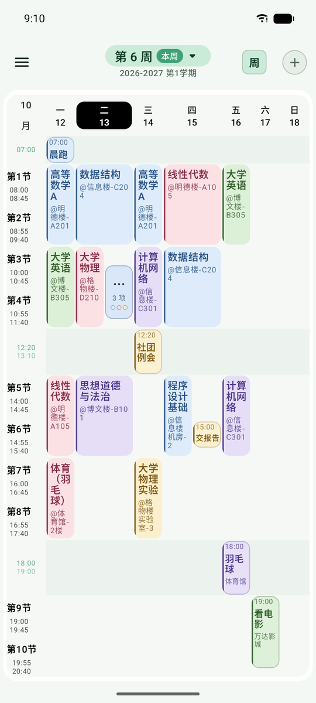 | 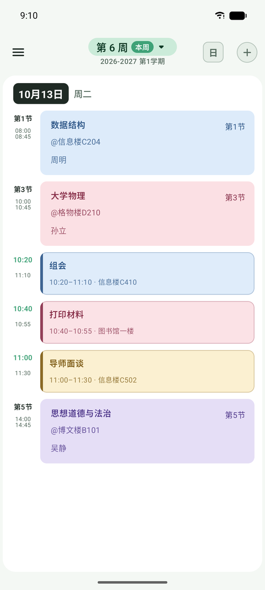 | 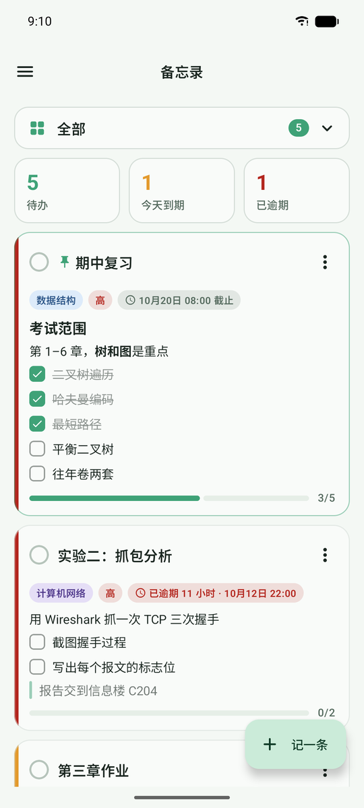 |
| Every period on one screen, with your own events placed at their real times | Swipe between days; events sit between classes | One notebook per course: checklists, priorities and due dates |

| Pinch to zoom | Class notice | Settings |
|:--:|:--:|:--:|
| 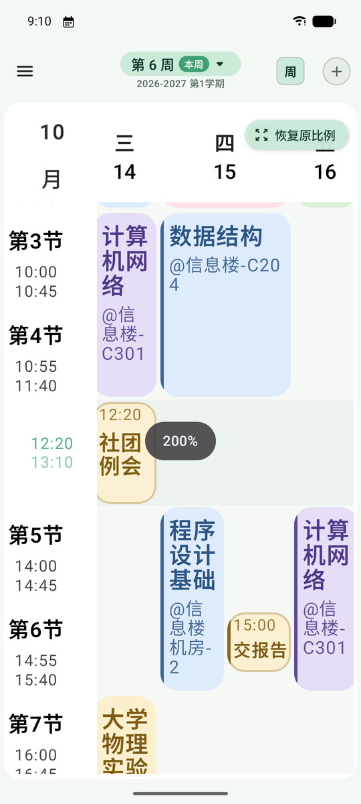 | 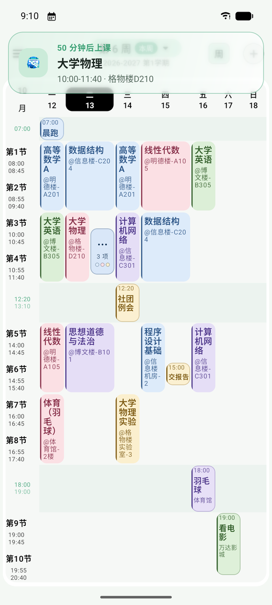 | 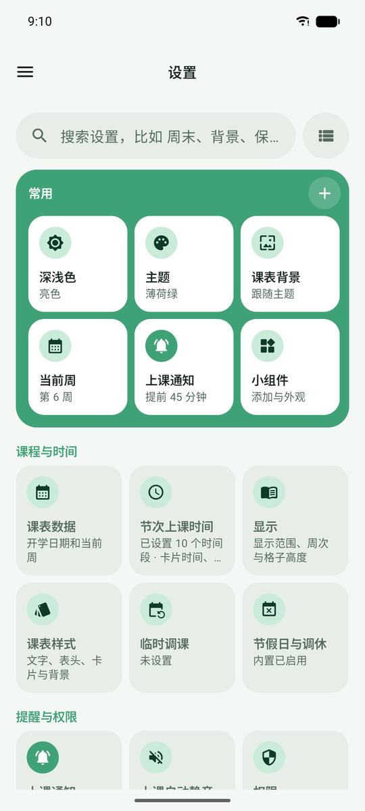 |
| Zoom up to 300% and pan freely; headers stay pinned | Course, time and room just before class, with a status bar chip | Search jumps straight to a setting; pick your own quick settings |

| Reminder settings | Manage list | Plugin marketplace |
|:--:|:--:|:--:|
| 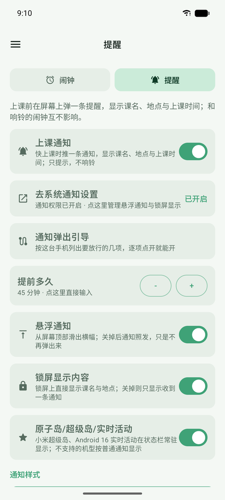 | 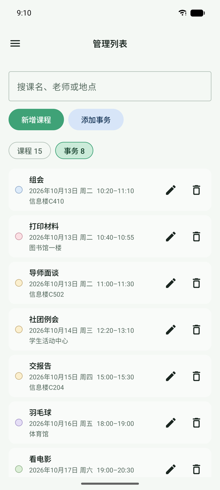 | 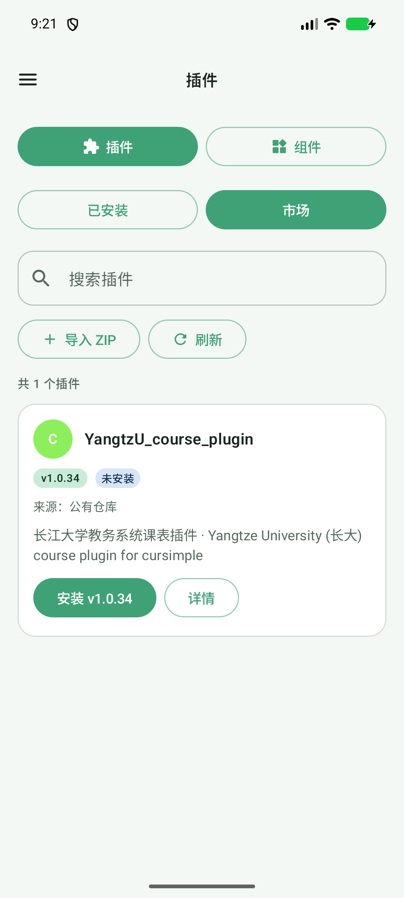 |
| Class notices and alarms managed separately, with a per-device setup guide | Courses and events in one searchable list | Search plugins and components; see sources, versions and installation status |

| Today's overview | Full-text note search | Alarm screen |
|:--:|:--:|:--:|
| 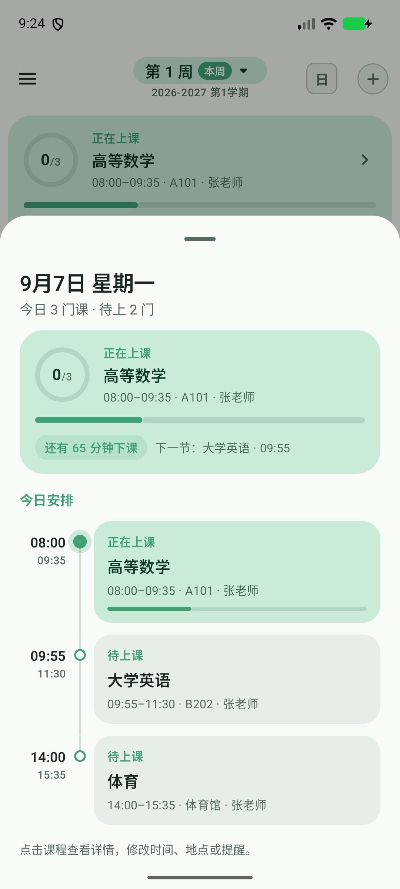 | 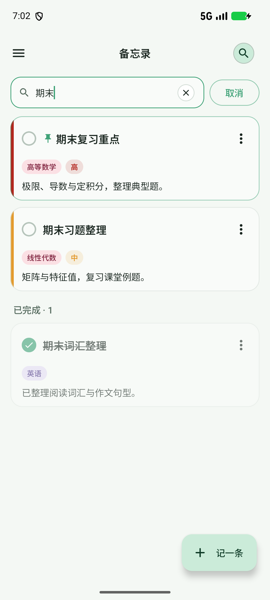 | 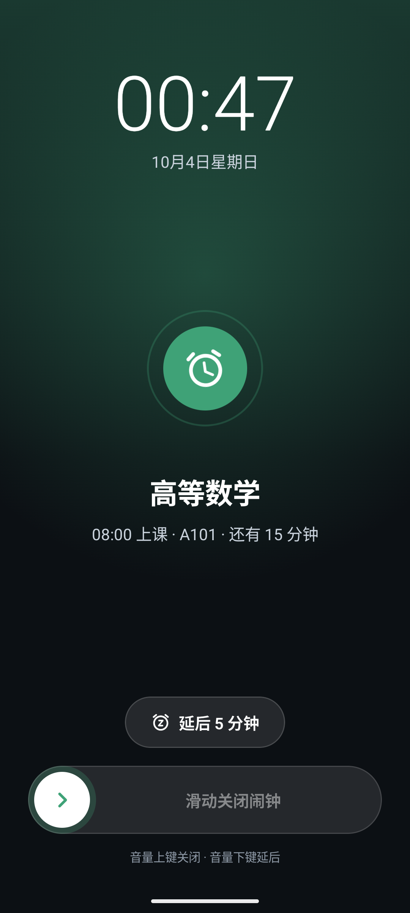 |
| Current and next class, countdowns, a full-day timeline and conflict details | Search titles, full text and courses across notebooks, including completed notes | Large clock, date and theme colours; slide to dismiss or tap to snooze |

| Course calendar widget | Pending tasks widget | Export to system Clock |
|:--:|:--:|:--:|
| 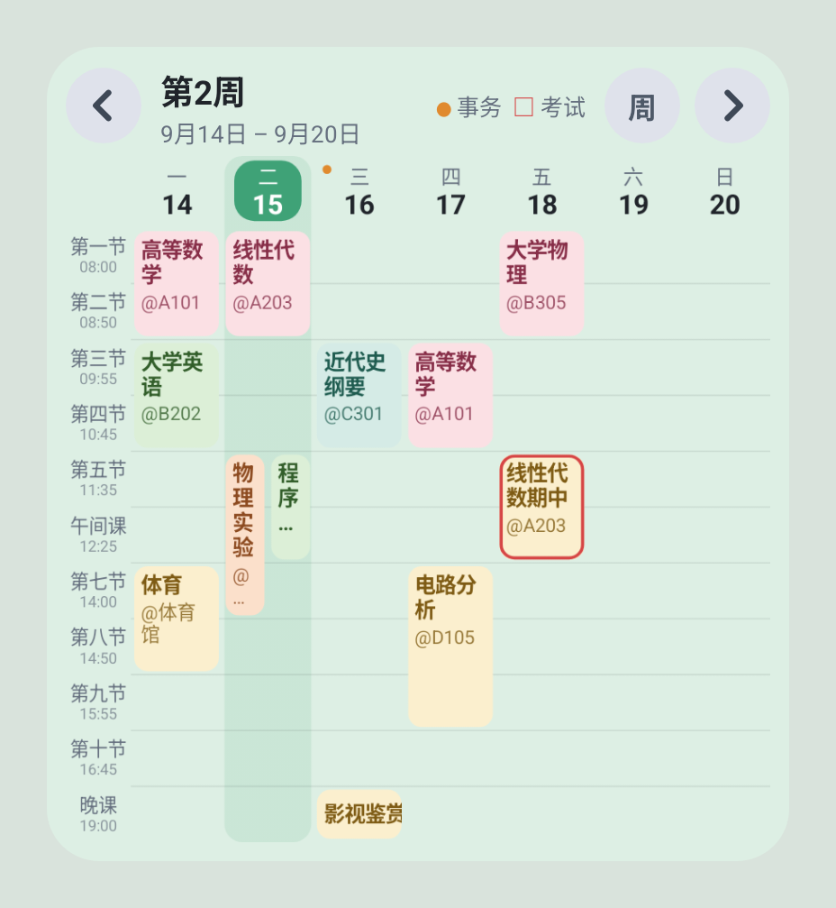 | 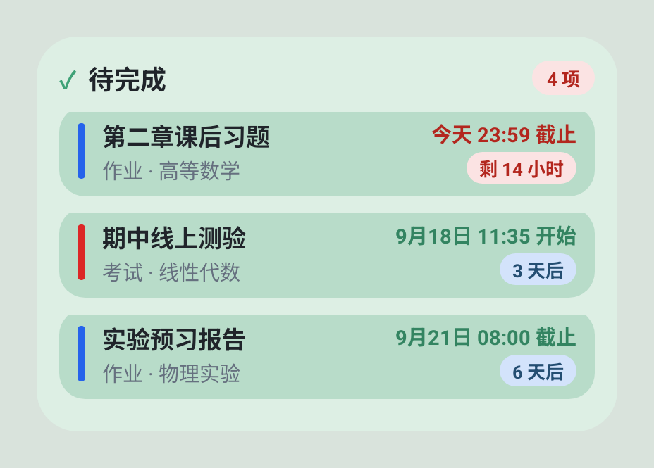 | 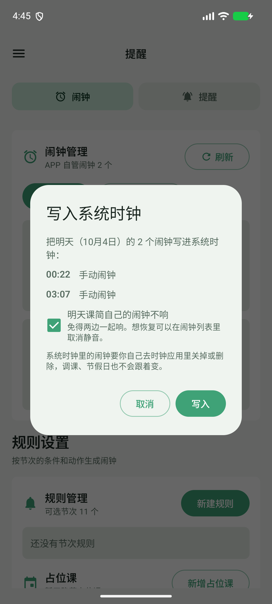 |
| Switch between a week timetable and month calendar; tap a date to open it | Unfinished items and due status from enabled components | Send tomorrow's alarms manually and verify them in Clock |

</div>

Screenshots use demo data; some show previously published versions.

## Build from source

Use **JDK 17** and an Android SDK containing `platforms;android-36`:

```bash
./gradlew assembleDebug       # com.x500x.cursimple.ci; coexists with the normal app
./gradlew assembleRelease     # ABI-specific and universal APKs; signing required
./gradlew testDebugUnitTest lintDebug
```

Maintain the version in `gradle.properties`:

```properties
app.versionCode=35
app.versionName=0.7.10
app.releaseChannel=beta
```

See [keystore.example.properties](keystore.example.properties) and [development notes](README_dev.md) for release signing. The current source supports component host **API 11**, with compatibility checks before installation.

| Module | Responsibility |
|---|---|
| `app` | Entry points, assembly, settings, updates, notices and generic component hosting |
| `core-kernel` | Shared models and protocols |
| `core-plugin` | Manifests, installation, web sessions and registry APIs |
| `core-data` | Repositories, preferences, note images and sharing |
| `core-reminder` | Rules, planning and delivery |
| `feature-schedule` | Timetable, events, notes and editors |
| `feature-plugin` | Markets, component pages and shared UI |
| `feature-widget` | Home screen presentation, actions and refresh |

Use the [plugin/component development guide](docs/plugin-system.md) for adapters and components. Components own their business logic, pages and platform protocols; the host supplies generic theme, notifications, storage and timetable capabilities.

## Troubleshooting

<details>
<summary>Missing notifications or alarms</summary>

Check notification permissions, channel importance, exact alarms, background access, Do Not Disturb, battery limits and device settings. Force-stopping clears scheduled plans; reopen the app. Verify exported alarms separately in Clock.

</details>

<details>
<summary>A component is missing or will not install</summary>

Check source settings, connectivity and the repository's Release ZIP/download manifest. Private sources require the correct read permissions. Check host/component compatibility if installation is rejected.

</details>

<details>
<summary>Notes are too large for a code or QR</summary>

Choose a CurSimple notes file for image notes or larger collections. The recipient selects the file from Import notes, previews it and confirms; notes map to course names and do not overwrite existing content.

</details>

<details>
<summary>A home screen widget is not refreshing</summary>

Check whether its component is installed, enabled and declares widgets, as well as background permissions. Remove and re-add if needed. On Huawei launchers, check the Android Widgets entry under Service widgets.

</details>

## Feedback and contributing

- [Bugs and suggestions](https://github.com/cursimple/cursimple-app/issues)
- [Discussions](https://github.com/cursimple/cursimple-app/discussions)
- [School plugins](https://github.com/cursimple/cursimple-plugins)
- [Extension components](https://github.com/cursimple/cursimple-components#contribute)

## License

[MIT License](LICENSE) · Copyright © 2026 CurSimple contributors
