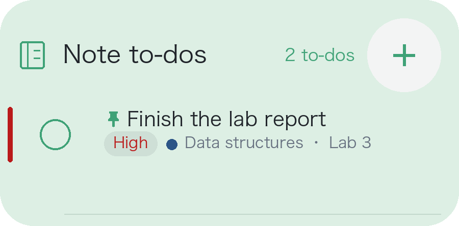
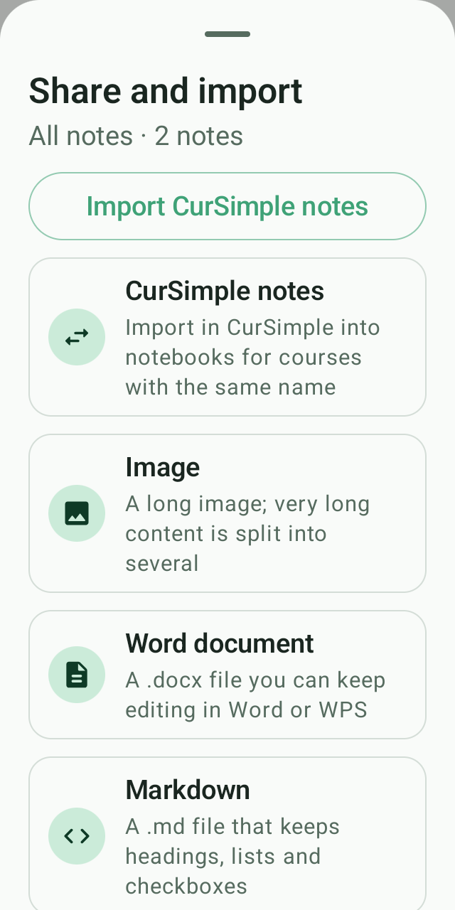
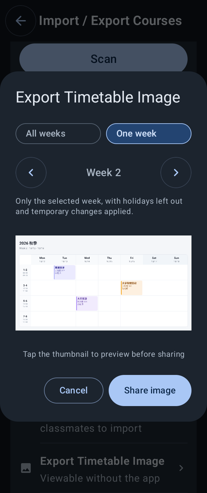
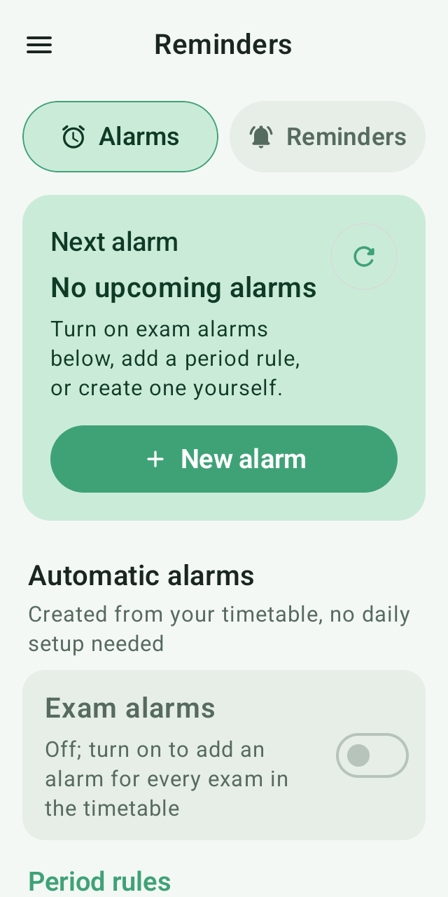
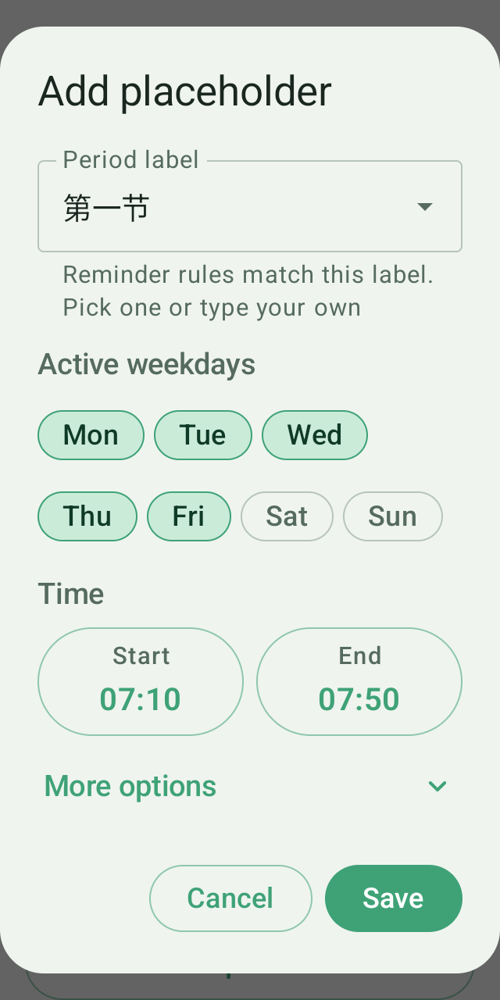

# CurSimple · Local update preview

## Desktop tasks

The widget uses small, single-circle check controls, priority stripes and text labels. Tapping a check control asks for confirmation before marking the task complete. Cancel or go back to leave its status unchanged. Completing a whole note or a checklist item inside the app also requires confirmation to prevent accidental taps.

Tap task content to open a native mini editor for checklists and lists; use + to add a task and choose its course. Saving asks for confirmation. The editor keeps a fixed size. Opening, closing and switching settings use no zoom, movement or size animation; only pressed-state feedback remains. The keyboard stays closed on entry. Desktop completion is confirmed in a floating prompt without opening the note page.

## Share notes

Notes can include images with thumbnails, tap-to-open previews, pinch zoom and panning. Insert links, inline code and dividers from a compact scrolling toolbar. An edge fade and arrow show when more tools are available and disappear at the end; undo and redo move to the upper right. Images travel with notes files and backups and appear in Word and image exports. Markdown with images exports as a ZIP bundle.

Share all notes or one note as a share code, QR code or CurSimple notes file. Recipients can paste a code, scan it or read an image, preview the import and add notes to matching course notebooks. QR images can be saved and shared. Images, Word, Markdown and plain text are also available; Word files remain editable.

## Share preview

Import and export actions are reorganized. Save or share timetable QR images, or import a shared timetable code. Image sharing shows a thumbnail you can open and zoom before sending.

## Alarms & alerts

The redesigned screens group upcoming alarms, automatic rules and default settings. Common actions are easier to find, with less-used settings folded away.

## Placeholder

Select weekdays directly and use time pickers for the start and end. Weeks and names sit under More options, reducing manual input.

## More interface improvements

- Date pickers support swiping left for the next month and right for the previous month, with a smooth transition. Browsing preserves the selected date; arrows and date taps remain available.

- The Yangtze University import plugin card has a separate Plugin settings button. Midday and evening row switches default on and update the current local timetable immediately without reimporting. Empty rows can be removed; rows with actual classes remain visible and are checked again after importing or rescheduling. This applies only to timetables imported by the Yangtze University plugin with its complete eight-row format, including midday and evening rows; other sources and formats are unaffected. Older plugin imports can confirm their legacy source once in settings to use both switches without reimporting.
- Course details show the session number below the heading (for example, 1/18), combining same-named courses across weekdays and periods. Counts follow actual rescheduled dates; moved-away or cancelled meetings do not count at their old position. Holidays count by default and can be excluded in Settings → Display.
- Long-press a course and choose Add course here to create another course with the same scheduled weekday and full period span. Enter and save its details independently.
- Open component goes directly to the installed component home; settings open from there.
- Buttons beside teacher and location fields open weekly settings. Drag horizontally to select several weeks, apply one value or use the default; cancelling leaves the course unchanged. Details show the matching teacher and location.
- Reuse course names, teachers and locations from all saved timetables using searchable dropdowns with a bounded, scrollable height. Choosing a course prefills its name, teacher and location while keeping the current weekday, periods and weeks. Weekly settings and event locations also offer saved values.
- The weekly timetable widget highlights the current time slot across today's column to locate the current class. Tap a class in the mini weekly widget to open the same course details in a read-only desktop dialog, including the matching teacher, location, note and session count. Overlapping classes can be paged individually; closing returns to the launcher.
- YuKeTang courseware uses sharper images and text, with tap zoom, pinch, swipe and portrait/landscape controls.
- YuKeTang sign-in opens SMS verification directly. The WeChat QR option is removed; task details retain Open YuKeTang.
- About pages use smaller version text and open-source labels. The main app shows Beta or Stable according to its release channel.
- Notification previews display the selected style without an extra bottom tip. Times and short labels adapt to narrow screens and larger fonts.

## Fixes and reliability

- After about five seconds on the Yangtze timetable page without automatic import, a hint offers Upload schedule and the automatic-capture overlay no longer blocks page controls. Incomplete runs retry, active imports are not duplicated, and manual upload waits for a ready draft. When the timetable page shows several curriculum tabs, capture stops on the page so you can pick one and upload it yourself, instead of merging them. Primary and minor programme grids use their own period layouts; weekdays, separate period ranges, row spans and reordered course-list columns are handled independently.

- Course details keep a fixed frame within the available screen. The body scrolls separately and bottom actions remain visible. Overlapping courses use a compact pager with a smooth content change, avoiding repeated window resizing. Closing the desktop note editor no longer changes its window size or plays an exit animation.

- Image and courseware previews handle Back as separate overlay layers, keeping the detail sheet and component open in normal mode. Available originals are preferred; high-resolution retries refresh courseware metadata instead of reusing expired URLs. Thumbnail-only sources remain clearly identified; missing detail cannot be reconstructed.

- Midday and evening row visibility checks each timetable’s recorded importer and complete period format. It no longer falls back to all installed plugins; shared codes, QR and AI imports do not inherit importer metadata. For timetables imported by older plugin versions, confirm the legacy source once in Plugin settings. The complete format check then enables the switches immediately, with no sign-in or reimport. The reversible display link belongs to that timetable only and is never assigned to other timetables automatically.

- Completion checks the current task content to avoid duplicate changes or completing an outdated checklist item. The desktop confirmation button is disabled while saving to prevent repeated taps.
- Removed duplicate implementations, unused dependencies, obsolete text and old assets to reduce APK size. Background keep-alive, alarms and recent core features are preserved.
- Desktop editing avoids duplicate refreshes after saving. Closing preserves window bounds and disables system zoom transitions; launcher behavior still needs device testing.
- Task settings use a separate panel in the floating editor. Switching panels retains drafts and undo history; settings no longer expand outside the visible area.
- Fixed stretched checkboxes and misplaced notebook colour dots in the task widget preview. Checkboxes stay square and colour dots sit beside the notebook label.
- Course alarms no longer trigger a same-named class on another weekday. Real timetable moves follow the new date and time.
- Signing in starts one automatic sync that continues after classroom navigation. Saved accounts restore on reopening, and failed navigation can be retried.
- Courseware sync reads official completion and merges duplicate sources. Undated materials do not inherit the course end date.
- Repeated note imports skip existing content and retain text, priority and pins.
- Announcements follow the app language in Simplified Chinese, Traditional Chinese and English, with separate caches.
- Improved system notification and lock-screen fallback. Live notification presentation depends on system permissions and device support.

## Installation and testing

Use the paired local APK and YuKeTang component 1.3.8. Removing QR sign-in does not actively clear saved sessions. Review and complete courseware in YuKeTang; the next sync updates official progress.

Huawei instructions point to Widgets at the bottom of Service widgets. Native HarmonyOS service widgets are still being integrated and have not been verified on a device. Phone notification delivery, SMS sign-in and orientation switching still need device testing.

This is a local testing preview. Nothing has been published or pushed.
