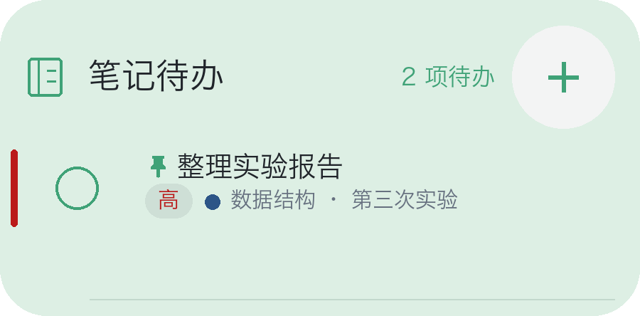
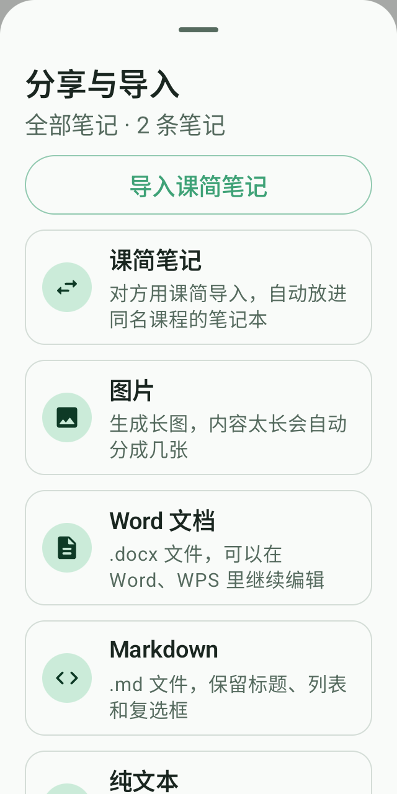
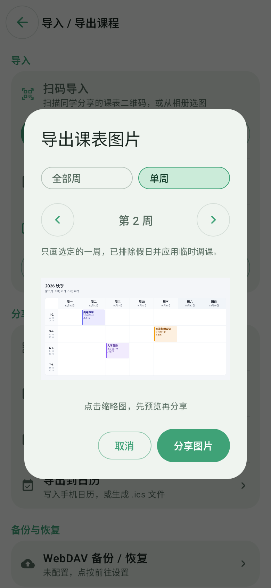
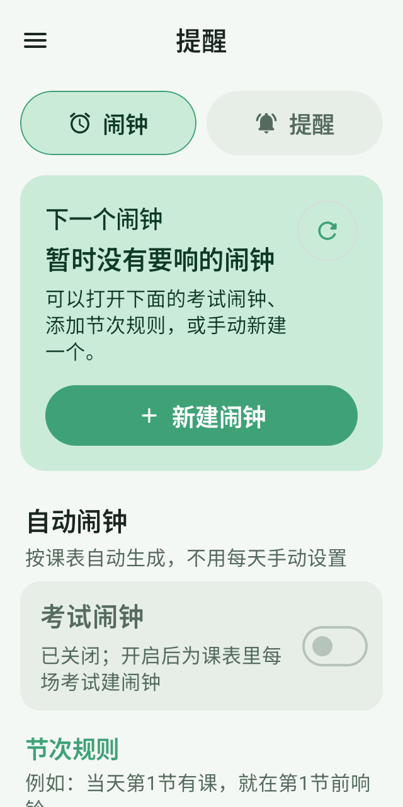
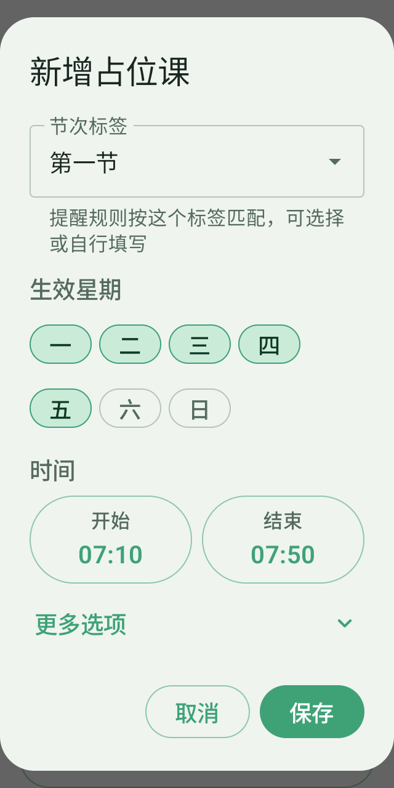

# 课简 · 本地更新预览

## 桌面待办操作

桌面勾选框改为单个小圆圈，优先级用颜色条与文字标签。点击勾选框先弹出「确认完成」，确认后才改变状态；取消或返回保持原状。软件内的整条笔记和清单单项也需要二次确认，减少误触。

点内容打开原生迷你编辑器，可编辑清单和列表；点「＋」新增并选择课程，保存前确认。编辑浮窗固定尺寸，打开、关闭与设置切换不再使用缩放、位移或尺寸动画，仅保留点击反馈，默认不弹出键盘。桌面确认完成在浮窗内处理，无需进入笔记页面。

## 笔记分享与导入

备忘录可插入图片，支持缩略图、点击放大、双指缩放与拖动；插入链接、行内代码和分隔线也可直接使用。底部改为小图标横向工具栏，边缘渐变与箭头提示还有更多工具，滚到尽头自动消失；撤销、重做移到右上角。图片随课简笔记文件和备份携带，Word 与长图也会包含图片；Markdown 含图片时打包为 ZIP。

全部笔记和单篇笔记都能选择分享码、二维码或课简笔记文件。接收方可粘贴分享码、扫码或从相册识别，预览后导入同名课程笔记本；二维码支持保存和分享。另支持图片、Word、Markdown 和纯文本，Word 文件可继续编辑。

## 课表分享先预览

导入与导出入口重新整理。课表二维码可保存、分享，也可用分享字符导入；课表图片先看缩略图，点开可放大，再确认分享。

## 闹钟提醒更清晰

闹钟与提醒界面重新排布，将近期闹钟、自动规则和默认设置分组展示。常用操作更容易找到，不常用的设置收进折叠选项。

## 占位课点选设置

生效星期直接点选，开始与结束时间使用时间选择器。周次与名称放在「更多选项」，减少手动输入。

## 其他界面改进

- 日期选择器支持左滑到下个月、右滑到上个月，切换带过渡动画；浏览月份保留已选日期，原有箭头和日期点击继续可用。

- 长江大学教务插件卡片新增独立「插件设置」按钮，午间课、晚间课显示开关默认开启，切换立即更新本地课表，无需重新导入。空时段可关闭并移除对应课表行；实际有课程时保持显示，导课、调课后也会重新检查。 仅适用于由长江大学教务插件导入、完整匹配八行节次格式且包含午间课和晚间课的课表，不影响其他来源或其他格式的课表。旧版插件导入的课表可在设置中确认一次来源，立即使用这两个开关，无需重新导入。
- 课程详情在标题下显示上课次数（如 1/18），合并同名课程在不同星期、节次的安排。按调课后的实际日期统计，原位置调走或取消的课不计；默认计入假期，可在「设置 → 显示」关闭。
- 长按已有课程可「在此位置添加课程」，沿用该位置的排课星期与完整节次范围，新课程独立填写并保存。
- 已安装组件的「打开组件」直接进入主页，设置从组件主页进入。
- 授课教师与地点输入框旁保留每周设置按钮，支持横向滑选多个周次，统一修改或沿用默认值；取消不会改动课程。课程详情展示对应周的教师与地点。
- 课程名、教师、地点支持从所有已保存课表中快速复用，下拉列表限制高度并可滚动、搜索。选择已有课程可预填名称、教师和地点，保留当前排课星期、节次及周次；各周设置和事务地点也可选择已有值。
- 周课表小组件新增当前课时横向高光，与当天列交叉定位正在进行的课程。点击迷你周课表的课程，在桌面直接打开与软件内一致的只读课程详情，可查看对应周的教师、地点、备注和上课次数；重叠课程可逐门切换，关闭返回桌面。
- 雨课堂课件使用高清图片与文字预览，支持单击放大、双指缩放、左右翻页和横竖屏按钮。
- 雨课堂登录页直接使用短信验证码，移除微信扫码入口；详情保留「前往雨课堂」查看学习任务。
- 关于页缩小版本号与开源标签；主体按发布渠道显示「测试版」或「正式版」。
- 通知预览直接展示选定样式，移除额外的底部说明提示；关键时间和短标签优化窄屏与大字号排布。

## 修复与稳定性

- 长江教务课表页面等待约 5 秒仍未自动导入时，提示点击「上传课表」；长时间等待后解除自动抓取遮挡，保留网页手动操作。未完成的脚本可重试，正在运行的导入不会重复启动，手动上传等待草稿准备好后再提交。课表页顶部有多个培养方案标签时不再自动抓取，停在页面等你选好再手动上传，避免多张表混成一份。主修、辅修各表分别读取节次排布，跨星期、不连续节次拆开处理，跨行节次与课程列表列序也按各自页面识别。

- 课程详情弹窗按屏幕可用范围固定边界，正文单独滚动，底部编辑、闹钟等操作保持可见；同位置课程切换简化为紧凑分页，内容平滑切换，避免窗口反复伸缩。桌面笔记保存关闭不再重设窗口尺寸或播放退场动画。

- 雨课堂图片放大与课件阅读登记独立返回层级，返回先关闭最上层预览，保留内容详情和组件页面；普通模式也生效。课件优先读取可用原图，高清失败后的重试重新获取课件信息，避免反复使用过期图片链接。仅提供低清封面的页面继续明确提示，无法凭空补出细节。

- 午间课、晚间课隐藏同时核验每份课表的导入来源和完整节次格式，不再回退匹配所有已安装插件；分享码、二维码和 AI 导入不继承教务导入标记。旧版插件导入的课表可在「插件设置」确认一次旧插件来源，完整格式匹配后立即启用，无需登录或重新导入。兼容绑定只保存到当前这份课表，可取消；其他课表不会自动套用。

- 待办确认时检查任务内容，避免重复完成或修改过期的清单项；桌面保存期间禁用确认按钮，防止连续点击。
- 清理重复实现、未使用依赖、废弃文案和旧素材，优化安装包体积；保留保活、闹钟和近期核心功能。
- 桌面编辑保存后去除重复刷新，关闭时不再重设窗口尺寸，并禁用窗口退场动画；实际桌面效果仍需手机验证。
- 桌面待办设置改为浮窗内独立面板，切换保留草稿与撤销记录；固定加载与编辑尺寸，关闭默认放大过渡，修复设置落在视口外和打开时自动聚焦导致窗口跳动的问题。
- 修复笔记待办预览的勾选框拉长、标签色点越界问题，勾选框保持正方形，色点显示在标签旁。
- 修复单课闹钟在另一星期的同名课上误响；实际调课后跟随新日期和节次。
- 登录成功后自动同步一次，进入课堂不会中断同步；已保存账号再次打开时恢复，页面失败可重试。
- 雨课堂课件同步读取官方完成状态，合并重复来源；没有明确截止时间的课件不使用结课日期。
- 笔记重复导入时跳过已有内容，保留正文、优先级与置顶信息。
- 更新公告提供简体中文、繁体中文和英文，随应用语言切换，各语言缓存独立。
- 完善系统通知与锁屏显示回退；实时通知效果仍取决于系统权限和设备支持。

## 安装与测试说明

请使用配套本地 APK 和雨课堂组件 1.3.8。移除扫码不会主动清除已有登录会话；课件学习与完成情况请前往雨课堂查看，下次同步更新。

华为桌面入口补充「服务卡片」底部的「窗口小工具」说明；鸿蒙原生服务卡片仍在接入测试，尚未完成真机验证。手机上的通知送达、短信登录与横竖屏切换仍需实机确认。

本页为本地测试预览，未发布或推送。
