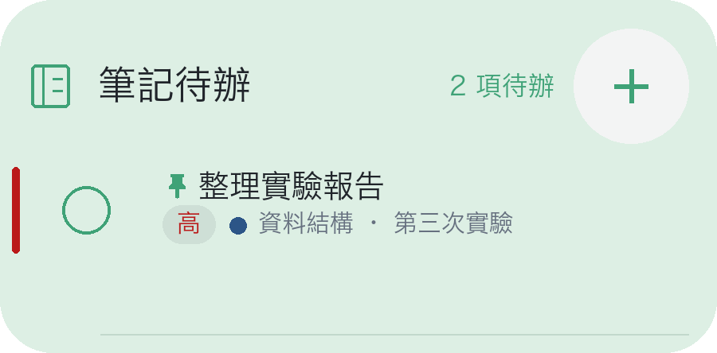
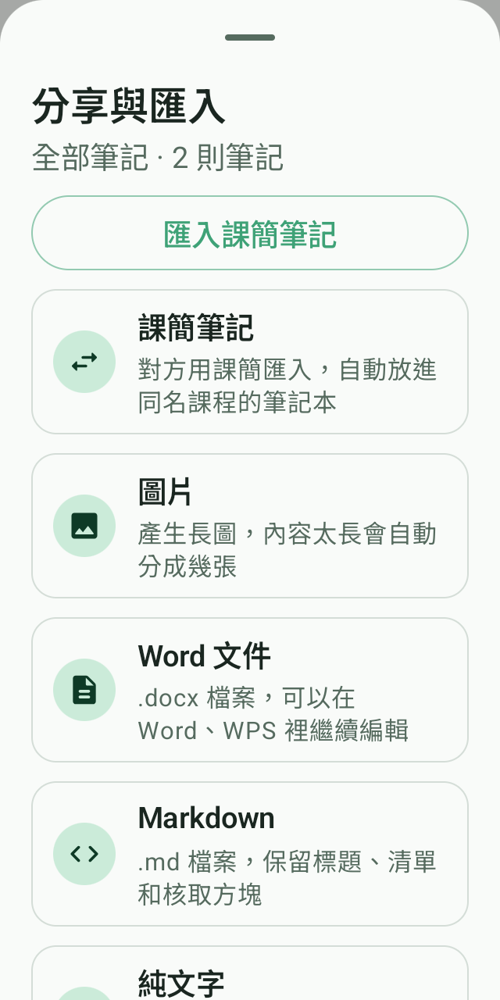
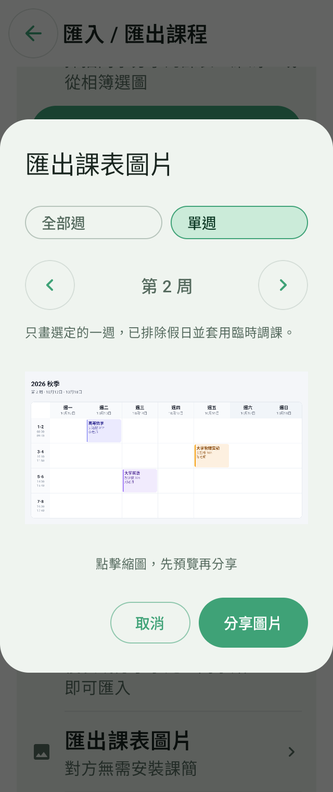
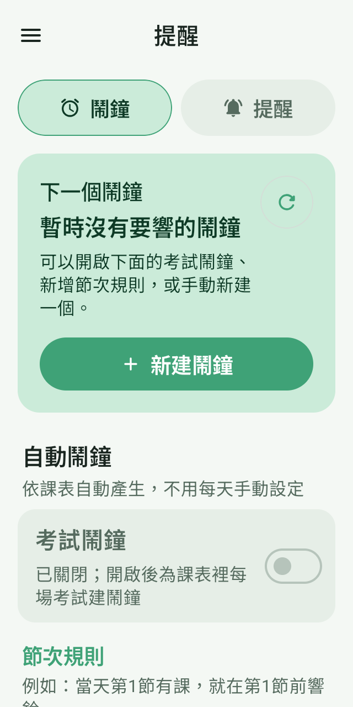
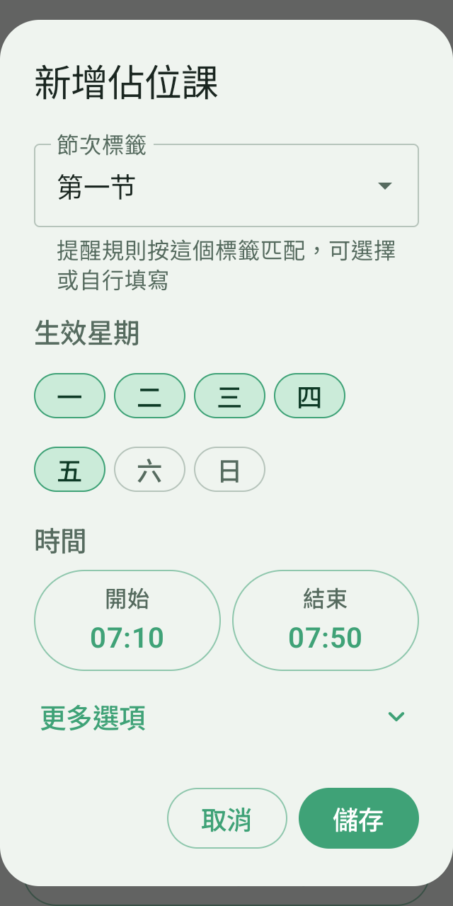

# 課簡 · 本地更新預覽

## 桌面待辦操作

桌面勾選框改為單個小圓圈，優先順序用色條與文字標籤。點擊勾選框先顯示「確認完成」，確認後才改變狀態；取消或返回保持原狀。軟體內的整篇筆記與清單單項也需要二次確認，減少誤觸。

點內容開啟原生迷你編輯器，可編輯清單與列表；點「＋」新增並選擇課程，儲存前確認。編輯浮窗固定尺寸，開啟、關閉與設定切換不再使用縮放、位移或尺寸動畫，僅保留點擊回饋，預設不彈出鍵盤。桌面確認完成在浮窗內處理，無需進入筆記頁面。

## 筆記分享與匯入

備忘錄可插入圖片，支援縮圖、點擊放大、雙指縮放與拖曳；插入連結、行內程式碼與分隔線也可直接使用。底部改為小圖示橫向工具列，邊緣漸變與箭頭提示還有更多工具，捲到盡頭自動消失；復原、重做移到右上角。圖片隨課簡筆記檔案與備份攜帶，Word 與長圖也會包含圖片；Markdown 含圖片時打包為 ZIP。

全部筆記與單篇筆記都能選擇分享碼、QR 碼或課簡筆記檔案。接收方可貼上分享碼、掃描或從相簿辨識，預覽後匯入同名課程筆記本；QR 碼支援儲存與分享。另支援圖片、Word、Markdown 與純文字，Word 檔案可繼續編輯。

## 課表分享先預覽

匯入與匯出入口重新整理。課表二維碼可儲存、分享，也可用分享字串匯入；課表圖片先看縮圖，點開可放大，再確認分享。

## 鬧鐘提醒更清楚

鬧鐘與提醒介面重新排布，將近期鬧鐘、自動規則與預設設定分組展示。常用操作更容易找到，不常用的設定收進摺疊選項。

## 占位課點選設定

生效星期直接點選，開始與結束時間使用時間選擇器。週次與名稱放在「更多選項」，減少手動輸入。

## 其他介面改進

- 日期選擇器支援左滑到下個月、右滑到上個月，切換有過渡動畫；瀏覽月份保留已選日期，原有箭頭與日期點選繼續可用。

- 長江大學教務插件卡片新增獨立「插件設定」按鈕，午間課、晚間課顯示開關預設開啟，切換立即更新本地課表，無需重新匯入。空時段可關閉並移除對應課表列；實際有課程時保持顯示，匯入、調課後也會重新檢查。 僅適用於由長江大學教務插件匯入、完整符合八行節次格式且包含午間課和晚間課的課表，不影響其他來源或其他格式的課表。舊版插件匯入的課表可在設定中確認一次來源，立即使用這兩個開關，無需重新匯入。
- 課程詳情在標題下顯示上課次數（如 1/18），合併同名課程在不同星期、節次的安排。按調課後的實際日期統計，原位置調走或取消的課不計；預設計入假期，可在「設定 → 顯示」關閉。
- 長按已有課程可「在此位置新增課程」，沿用該位置的排課星期與完整節次範圍，新課程獨立填寫並儲存。
- 已安裝元件的「開啟元件」直接進入首頁，設定從元件首頁進入。
- 授課教師與地點輸入框旁保留每週設定按鈕，支援橫向滑選多個週次，統一修改或沿用預設值；取消不會改動課程。課程詳情展示對應週的教師與地點。
- 課程名稱、教師、地點支援從所有已儲存課表中快速重用，下拉清單限制高度並可捲動、搜尋。選擇已有課程可預填名稱、教師與地點，保留目前排課星期、節次與週次；各週設定與事務地點也可選擇已有值。
- 週課表小工具新增目前課時橫向高光，與當天欄交叉定位正在進行的課程。點擊迷你週課表的課程，在桌面直接開啟與軟體內一致的唯讀課程詳情，可查看對應週的教師、地點、備註與上課次數；重疊課程可逐門切換，關閉返回桌面。
- 雨課堂課件使用高清圖片與文字預覽，支援單擊放大、雙指縮放、左右翻頁與橫直向按鈕。
- 雨課堂登入頁直接使用簡訊驗證碼，移除微信掃碼入口；詳情保留「前往雨課堂」查看學習任務。
- 關於頁縮小版本號與開源標籤；主體按發布渠道顯示「測試版」或「正式版」。
- 通知預覽直接展示選定樣式，移除額外的底部說明提示；關鍵時間與短標籤改善窄螢幕與大字號排布。

## 修復與穩定性

- 長江教務課表頁面等待約 5 秒仍未自動匯入時，提示點擊「上傳課表」；長時間等待後解除自動擷取遮擋，保留網頁手動操作。未完成的腳本可重試，正在執行的匯入不會重複啟動，手動上傳等待草稿準備好後再提交。課表頁頂部有多個培養方案標籤時不再自動擷取，停在頁面等你選好再手動上傳，避免多張表混成一份。主修、輔修各表分別讀取節次排布，跨星期、不連續節次分開處理，跨列節次與課程清單欄位順序也按各自頁面辨識。

- 課程詳情彈窗按螢幕可用範圍固定邊界，正文單獨捲動，底部編輯、鬧鐘等操作保持可見；同位置課程切換簡化為緊湊分頁，內容平滑切換，避免視窗反覆伸縮。桌面筆記儲存關閉不再重設視窗尺寸或播放退場動畫。

- 雨課堂圖片放大與課件閱讀登記獨立返回層級，返回先關閉最上層預覽，保留內容詳情與元件頁面；普通模式也生效。課件優先讀取可用原圖，高清失敗後的重試重新取得課件資訊，避免反覆使用過期圖片連結。僅提供低清封面的頁面繼續明確提示，無法憑空補出細節。

- 午間課、晚間課隱藏同時核驗每份課表的匯入來源與完整節次格式，不再回退比對所有已安裝插件；分享碼、二維碼與 AI 匯入不繼承教務匯入標記。舊版插件匯入的課表可在「插件設定」確認一次舊插件來源，完整格式符合後立即啟用，無需登入或重新匯入。相容綁定只儲存到目前這份課表，可取消；其他課表不會自動套用。

- 待辦確認時檢查任務內容，避免重複完成或修改過期的清單項；桌面儲存期間停用確認按鈕，防止連續點擊。
- 清理重複實作、未使用相依套件、廢棄文案與舊素材，縮減安裝包體積；保留背景保活、鬧鐘與近期核心功能。
- 桌面編輯儲存後移除重複重新整理，關閉時不再重設視窗尺寸，並停用視窗退場動畫；實際桌面效果仍需手機驗證。
- 桌面待辦設定改為浮窗內獨立面板，切換保留草稿與復原紀錄，修復展開後設定落在視窗外的問題。
- 修復筆記待辦預覽的勾選框拉長、標籤色點越界問題，勾選框保持正方形，色點顯示在標籤旁。
- 修復單課鬧鐘在另一星期的同名課上誤響；實際調課後跟隨新日期與節次。
- 登入成功後自動同步一次，進入課堂不會中斷同步；已儲存帳號再次開啟時恢復，頁面失敗可重試。
- 雨課堂課件同步讀取官方完成狀態，合併重複來源；沒有明確截止時間的課件不使用結課日期。
- 筆記重複匯入時略過已有內容，保留正文、優先順序與置頂資訊。
- 更新公告提供簡體中文、繁體中文與英文，隨應用語言切換，各語言快取獨立。
- 完善系統通知與鎖定畫面顯示回退；即時通知效果仍取決於系統權限與裝置支援。

## 安裝與測試說明

請使用配套本地 APK 與雨課堂元件 1.3.8。移除掃碼不會主動清除已有登入會話；課件學習與完成情況請前往雨課堂查看，下次同步更新。

華為桌面入口補充「服務卡片」底部的「視窗小工具」說明；鴻蒙原生服務卡片仍在接入測試，尚未完成實機驗證。手機上的通知送達、簡訊登入與橫直向切換仍需實機確認。

本頁為本地測試預覽，未發布或推送。
