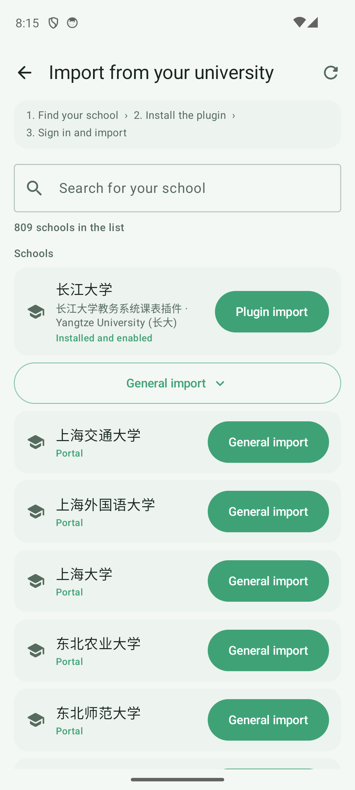
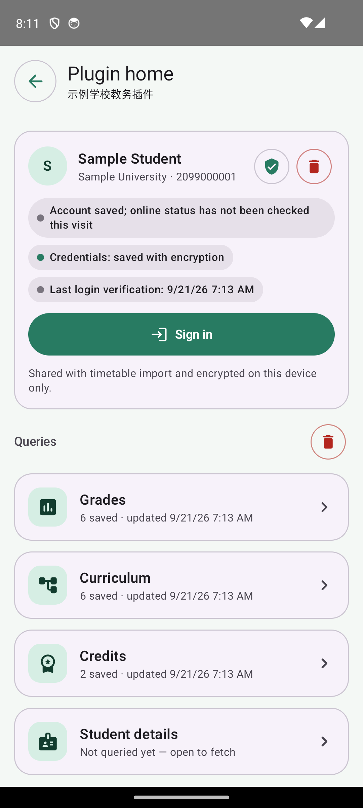
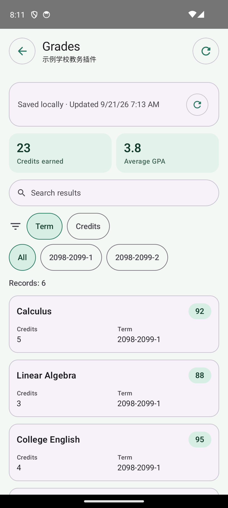
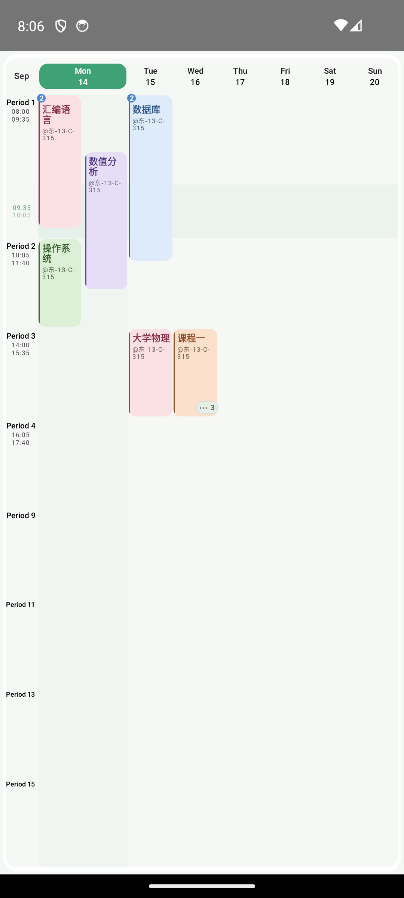
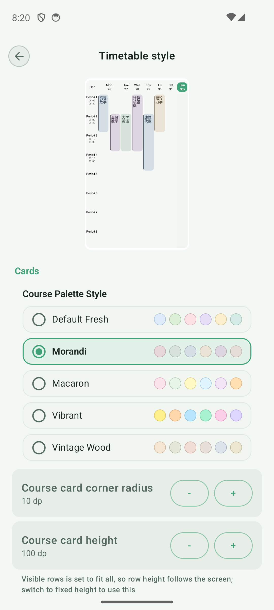
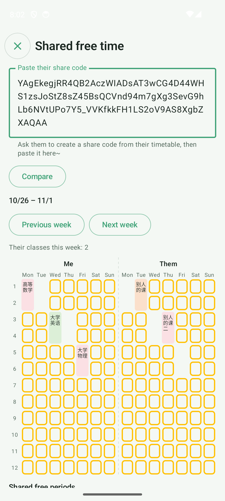
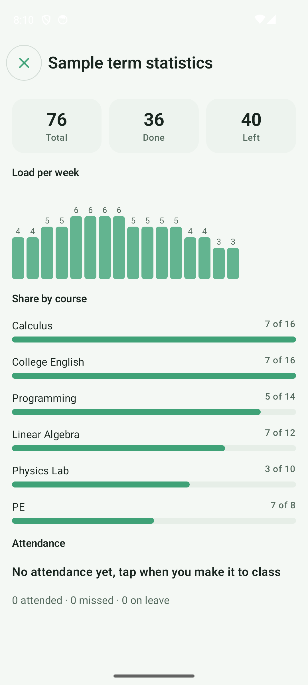
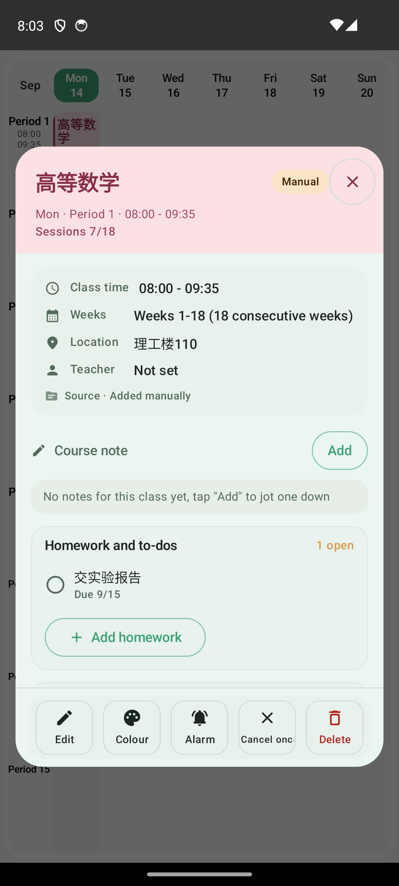
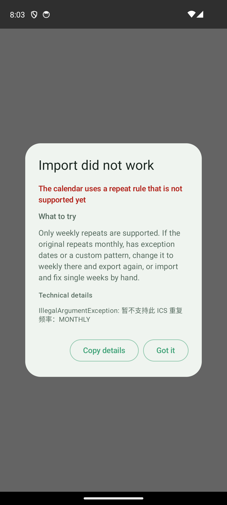

# 0.8.2 · Beta Release

0.8.2 brings together everything from the pre.1 to pre.3 test builds and the changes since: importing a timetable straight from your university's academic system (800+ schools), a plugin home page, crowded days that stay readable, per-course and per-event colours, shared free time, term copy and statistics, course todos and attendance, and a week view you can swipe between weeks. Third-party timetable import, system calendar sync and widgets are improved too. Enable Beta updates in the app to receive this update.

## Import from your university: 800+ schools

- Open "Import from your university" in the Add menu and search for your school. The list only includes academic systems that open directly from outside the campus network.
- Schools with a plugin show "Plugin import", the recommended way, with a collapsible "General import" below it that you can use if the plugin has a problem. Schools without a plugin go straight to "General import". If your school is not listed, enter its academic system address (https) to open it.
- General import reads the page only when you tap "Upload timetable" after signing in and opening your timetable page. Nothing is captured automatically. If it cannot read the page it keeps showing why: no timetable found, a timetable structure but no courses recognised, or N courses whose weeks or periods cannot be read. If even one course cannot be read, the whole timetable is left out, so no partial data is saved.
- It understands common layouts: grids, transposed tables, card lists and position-based timetables, plus single/double weeks, first/last eight weeks, ranges and other period and week notations.
- After importing, the result stays on the import page and the school's own period times are used. Your previous manual period table is kept, so you can switch back.
- General import has only been tried on a few schools so far. If it fails to read your school's page, please let us know.

## Plugin home: grades, curriculum and credits in one place

- Plugins that support it (such as the Yangtze University plugin) get a "Plugin home" button on the plugin page. It opens a menu: an account card on top, then Grades, Curriculum, Credits and Student details.
- Each item is its own page with summary figures, search and field filters. Record cards expand to show every field, and score-like fields become a badge at the top right of the card.
- Results are cached encrypted per account on this device and the network is only used when you refresh. If a refresh fails, the previous result stays.
- Your saved account is shared with timetable import and stays encrypted on this device. You can clear it on the page (with a confirmation; your timetable and cached results are kept).
- A failed refresh tells you why: the school's academic system cannot be reached (it may be under maintenance, and that is the school's problem), the phone has no network, or your login has expired (if your account is saved, you only need to enter the SMS code).
- Fixed a blank home page on some academic systems. The app no longer sends its package name in a request header that made the system return only a page fragment.

## Crowded-day timetable: every course stays readable

- Each day shows at most two side-by-side lanes: overlapping courses sit next to each other, and non-overlapping ones stack in the same lane. When several courses share a period, a small count appears at the top left of the card.
- When three or more courses share a time range, the two nearest to now stay visible and the rest fold into a button at the bottom right. Open it to see every course, with its time, room, teacher, and "In class now / Starts in N min / Finished".
- On tablets and in landscape, a day can show up to three lanes. When the width is not enough, the least busy days fall back to one lane so cards never shrink into one-character strips.
- Day headers show a small dot when courses are folded, today's column has a faint tint, and room numbers wrap at hyphens in narrow cards. The period column is narrower to give the timetable more room.

## Personal colours and per-course colours

- Five preset palettes: Default Fresh, Morandi, Macaron, Vibrant and Vintage Wood. Switch them in Settings → Timetable style, with a live mini timetable above.
- Courses and events can have their own fill colour, gradient blend and border, from the "Colour" button at the bottom of the course details or the bottom of the edit page.

## Swipe to change weeks

- Swipe left or right on the timetable grid to change weeks, with a smooth slide and fade.
- There is resistance at the first and last week so you do not swipe out of the timetable by accident.

## Shared free time

- Open "Shared free time" under Share and export: paste a classmate's share code and two real weekly timetables appear side by side, separated by a dashed line. Periods when both of you are free are outlined in yellow.
- Tap any course block for details. Below, the shared free periods are listed by day. You are on the left, and the other person's timetable name is on the right.
- Everything is calculated on your device; no server is needed.

## Term copy, archive and statistics

- In term management you can copy a term into a new one, keeping courses and time settings. Weeks and reminders are not carried over by default, and reminders can be kept if you choose.
- Old terms can be archived. They can still be viewed and counted, and the current term is not affected.
- The term statistics page shows total sessions, weekly load, each course's share and an attendance summary. The weekly bars show their number above each bar, and tapping or long-pressing a bar shows that week's load.

## Course todos and attendance

- Course details include "Homework and to-dos": add homework directly, and ticking one off asks first and is synced to your notes.
- Attendance (attended, missed, on leave) is recorded per course. It is collapsed into a single summary line and opens when tapped; the statistics page adds it up.
- The course form is regrouped into sections with weeks as their own block, and events are edited on the same full-screen page as courses.

## Sharing, import and system calendar

- Share codes now include the period times (Period 1, lunch period and so on) and the timetable's source name. When importing you can choose "Use the shared period times too", and course details show "Source · plugin name".
- The Import/Export page has a new "Third-party import" card with WakeUp, Xiao Ai timetable and generic ICS import.
- A failed import opens a diagnosis dialog with the reason and suggestions, and the details can be copied.
- Exporting to the system calendar adds a unique identifier to each event. Syncing again only makes incremental changes: removed or moved courses are cleaned up, changes to time and room are updated, and new courses are added. There is also a one-tap action to remove everything written to the system calendar.

## Widgets, backup and settings

- The notes widget can show more items and scroll.
- Widgets gain opacity, blur and dark-mode support, and there is a new course capsule widget.
- WebDAV supports weekly automatic backups, and the oldest ones are cleaned up once the limit is exceeded.
- Settings are regrouped into "Display" and "Style", and the groups can be collapsed. There is a new period column width setting.
- The "Theme" and "Background" buttons at the bottom of the sidebar first ask what you want to change: theme colour or timetable style, timetable background or widget background.
- Switching the manage list between weekday, name and source now animates consistently.

## Wording and details

- Empty states and placeholder hints are friendlier, in Simplified Chinese, Traditional Chinese and English.
- Fixed the "classes tomorrow" mix-up: it used to check only whether tomorrow was a holiday, and now checks whether you actually have classes.
- When no period times are set, the evening briefing no longer wrongly says there are no classes tomorrow.
- Tablets and foldables use a two-pane layout, with a live time line, an evening briefing, room-change reminders and exam reminders (exam reminders are off by default).
- The developer page has a new "Alarm test" that rings once about two seconds after you tap it, to check that alarms work. The plugin log filter buttons no longer squeeze into vertical text.

## Fixes and stability

- Fixed a crash in landscape and the timetable not scrolling in landscape.
- Hardened import, download, file provider, backup rules and plugin package parsing, with limits on file size and permissions; dependencies were updated.
- The seat number and ID reminder on exam cards now follow the app language in English and Traditional Chinese.
- The failure message when importing a Xiao Ai timetable and the due date in extension reminders now follow the app language.
