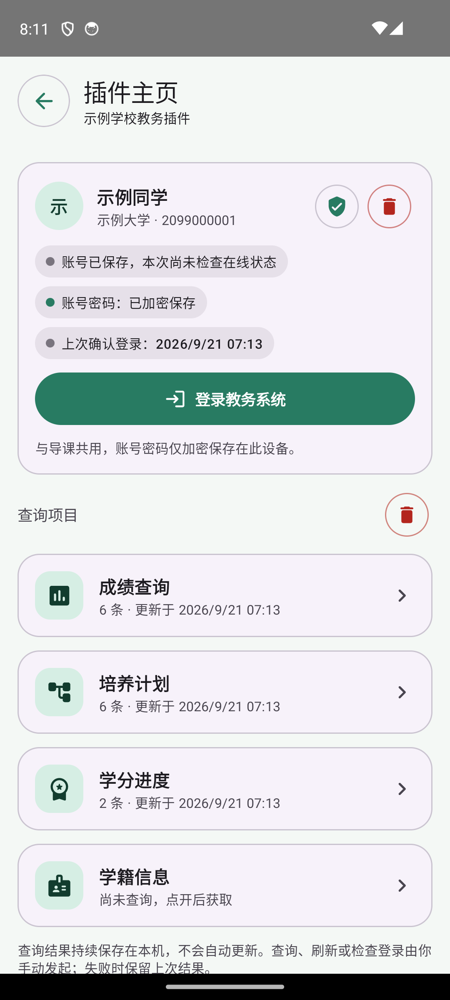
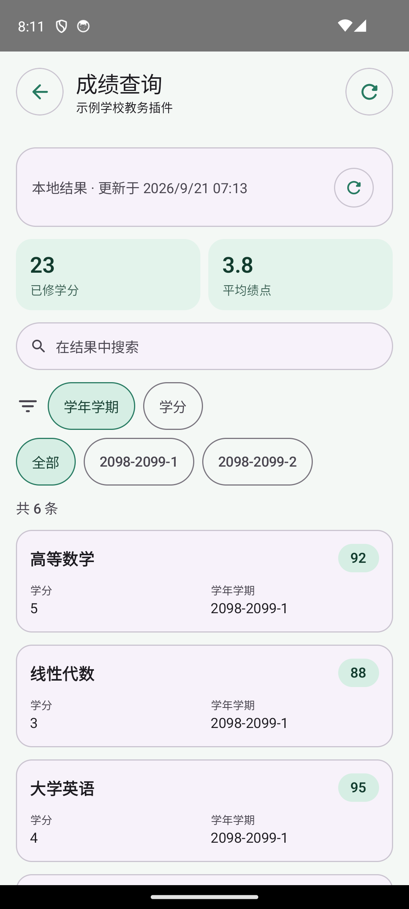
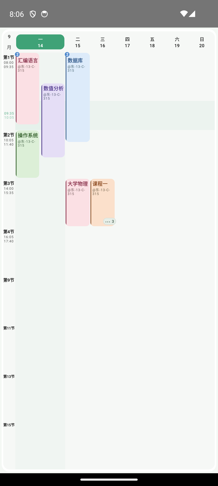
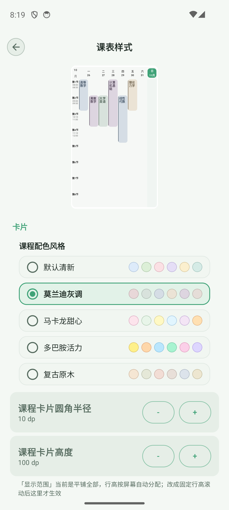
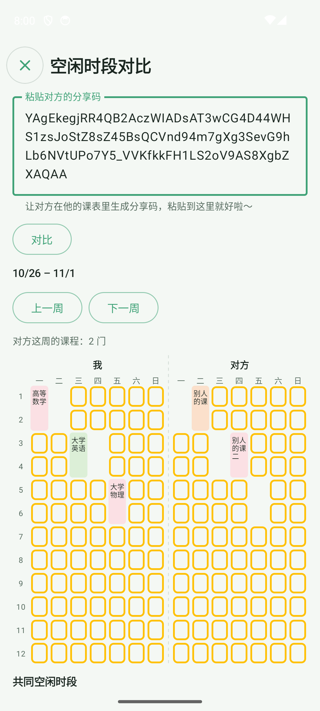
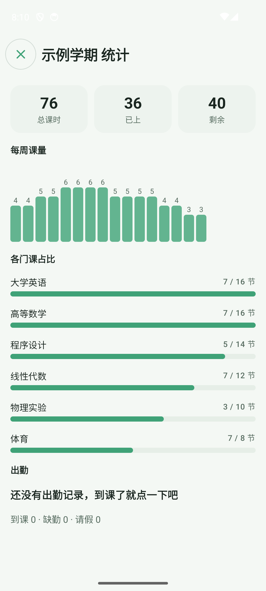
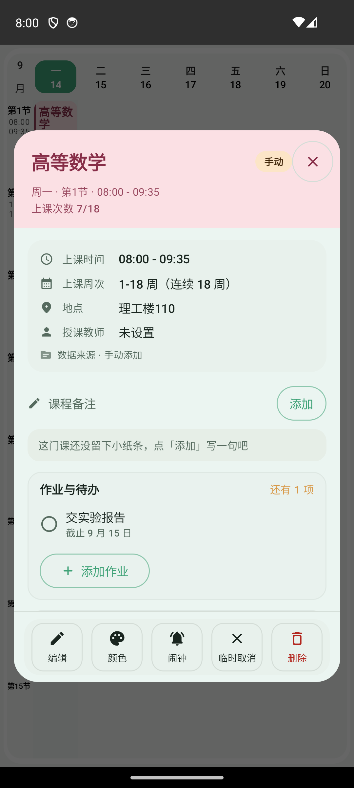
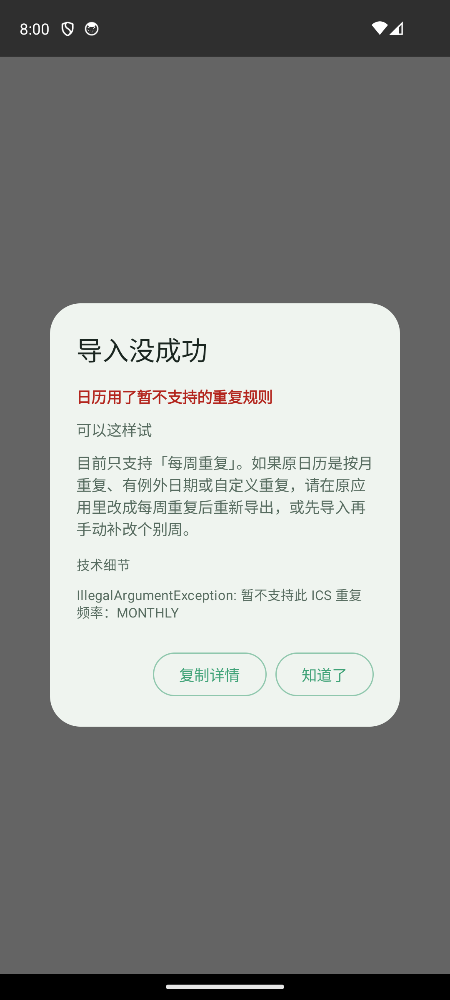

# 0.8.2 · 测试版

0.8.2 汇总了 pre.1 到 pre.3 三轮测试以及之后的全部改动：新增从教务系统导课（收录 800 多所学校）和插件主页；拥挤的日子能并排看清课程，课程和事务可以单独换色；新增共同空闲时间、学期复制与统计、课程待办与出勤；周课表可以横滑切周；第三方课表导入、系统日历增量同步和小组件也都有改进。应用内开启「测试版更新」后可接收本次更新。

## 从教务系统导课：收录 800 多所学校

- 在「添加」菜单里打开「从教务系统导课」，搜索你的学校。名单只收录能从校外直接打开的教务系统入口。
- 有插件的学校，右边是「插件导入」，推荐优先使用；下面可展开「通用导入」，插件出问题时可以改用它。没有插件的学校直接是「通用导入」。搜不到的学校，可以输入教务系统网址（https）直接打开。
- 通用导入：登录并进入课表页面后，点「上传课表」才会读取页面，不会自动抓取。识别不了时会一直显示原因（没有找到课表、找到课表结构但没识别出课程，或有 N 门课读不出周次、节次）。只要有一门课读不出来，整张课表都不会导入，不会留下残缺数据。
- 兼容常见课表写法：网格、转置表、卡片列表、按位置排版的课表，以及单双周、前八周、后八周、区间等周次和节次写法。
- 导入后结果留在导入页，并会改用学校自己的作息时间；原来的手动作息表仍保留，可以切回。
- 通用导入目前只在个别学校实测过，其他学校遇到识别失败，欢迎反馈。

## 插件主页：成绩、培养计划、学分一处查看

- 支持主页的插件（如长江大学教务插件），在插件页多一个「插件主页」按钮。点开是菜单：上面是账号卡片，下面是成绩查询、培养计划、学分进度、学籍信息。
- 每一项是独立页面：汇总数字、搜索、按字段筛选，记录卡片可展开看全部字段；成绩类字段会做成卡片右上角的标签。
- 查询结果按账号加密缓存在本机，只在你手动刷新时才联网；刷新失败时保留上次结果。
- 账号密码与导课共用，只加密保存在本机，可在主页清除（需二次确认，课表和查询缓存会保留）。
- 刷新失败会说明原因：学校的教务系统连不上（可能在维护，是学校官方系统的问题）、手机没有网络，或登录已过期（账号密码已保存时，只需输入短信验证码）。
- 修复了部分教务系统首页白屏：不再向网页发送应用包名请求头，教务系统不会再把页面当成局部刷新而返回残缺内容。

## 拥挤日课表：同一时段也能看清

- 每天最多并排两列：时间交叉的课左右排开，不交叉的课上下排在同一列。同一节有多门课时，卡片左上角显示课程数量。
- 同一时段 3 门以上时，保留离「现在」最近的两门，其余收进右下角的按钮。点开可查看全部课程，并显示时间段、教室、老师，以及「正在上课 / N 分钟后开始 / 已结束」。
- 平板和横屏宽度足够时，每天最多 3 列；放不下时，课最少的日子自动退回单列，卡片不会被压成一字一行。
- 有折叠内容的日期表头显示小圆点，今天的列加淡色底；窄卡片里教室号优先在连字符处换行。左侧节次列也进一步收窄，给课表更多空间。

## 个性化配色与单课调色

- 新增 5 种预设配色风格：默认清新、莫兰迪灰调、马卡龙甜心、多巴胺活力、复古原木。在「设置 → 课表样式」里切换，上方的迷你课表会实时预览。
- 课程和事务都可以自定义填充色、渐变混色和边框，入口在课程详情底部的「颜色」按钮和编辑页的最下面。

## 周课表横滑切周

- 课表网格区域支持左右横滑切换周次，带平滑的位移和淡入淡出动画。
- 到达第一周和最后一周时有边界阻尼，避免误翻出课表范围。

## 共同空闲时间

- 在「分享与导出」里打开「空闲时段对比」：粘贴同学的分享码，左右两张真实的周课表并排显示，中间用虚线隔开。两人都有空的时段用黄色框圈出。
- 点任意课程块可以看详情；下面按天列出共同空闲的节次。左边是「我」，右边显示对方的课表名。
- 数据只在本地计算，不需要服务器。

## 学期复制、归档与统计

- 学期管理页可以把已有学期「复制」为新学期，保留课程与时间设置。周次和提醒默认不带过去，提醒也可以选择保留。
- 旧学期可以「归档」。归档后仍可回看和统计，不影响当前学期。
- 学期「统计」页显示总课时、每周课量、各门课占比和出勤汇总。每周的柱状图直接在柱子上方显示数字，点击或长按可以看具体课量。

## 课程待办与出勤

- 课程详情里有「作业与待办」：可以直接添加作业，勾选完成前会先确认，并同步到备忘录。
- 课程可以记录出勤（出勤、缺勤、请假），默认收起为一行汇总，点开才展开；统计页自动汇总。
- 课程表单按区块重新分组，周次选择独立成段；事务也用和课程一样的全屏页编辑。

## 分享、导入与系统日历

- 分享码会带上作息时间（第一节、午间课等）和课表的来源名称。导入时可选「同时使用分享的作息时间」，课程详情会显示「来源 · 插件名」。
- 导入导出页新增「第三方导入」卡片，收纳 WakeUp、小爱课表和通用 ICS 导入。
- 导入失败时弹出诊断对话框，说明原因和建议，详情可以复制。
- 导出系统日历时，每个日程都会附加唯一标识。再次同步时只做增量更新：自动清理已删除或调走的课程，更新时间和地点的变化，并写入新课程。新增一键清除已写入系统日历的全部日程。

## 小组件、备份与设置

- 备忘录小组件可以显示更多条目并支持滚动。
- 小组件新增透明度、模糊和深色适配，并新增课程胶囊小组件。
- WebDAV 支持每周自动备份，自动备份数量超出后清理最旧的一批。
- 设置页按「显示」和「样式」重新分组，分组可以折叠。新增时间列宽度设置。
- 侧边栏底部的「换主题」「换背景」会先让你选类型：主题色或课表样式，课表背景或小组件背景。
- 管理列表按星期、名称、来源切换排序时，动画保持一致。

## 提示语与细节

- 空状态和占位提示改得更活泼，简体、繁体、英文都有。
- 修复「明天要上课了」的误判：以前只看明天是不是假期，现在看明天是否真的有课。
- 没有设置作息时间时，晚间简报不再误报「明天没有课程」。
- 平板和折叠屏使用双栏布局，并新增实时时间线、晚间简报、换教室和考试提醒（考试提醒默认关闭）。
- 开发者页面新增「闹钟测试」，点一下约 2 秒后响一次，用来检查闹钟是否正常；插件日志的筛选按钮不再被挤成竖排。

## 修复与稳定性

- 修复横屏下的崩溃，以及横屏无法滚动的问题。
- 加固导入、下载、文件提供器、备份规则和插件包解析，限制文件体积与权限；更新了依赖。
- 考场卡片中的座位号和证件提示，在英文和繁体环境下改为对应语言。
- 小爱课表导入失败的提示和扩展组件的到期提醒日期，改为跟随应用语言显示。
