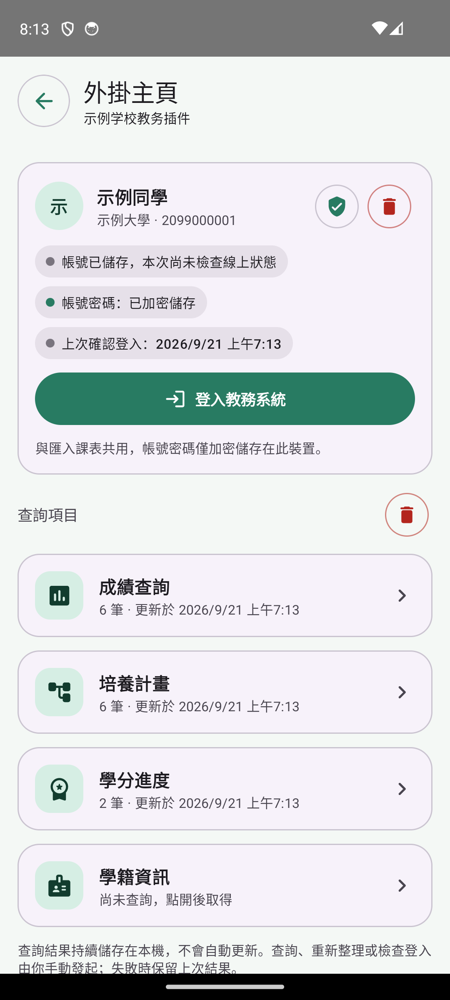
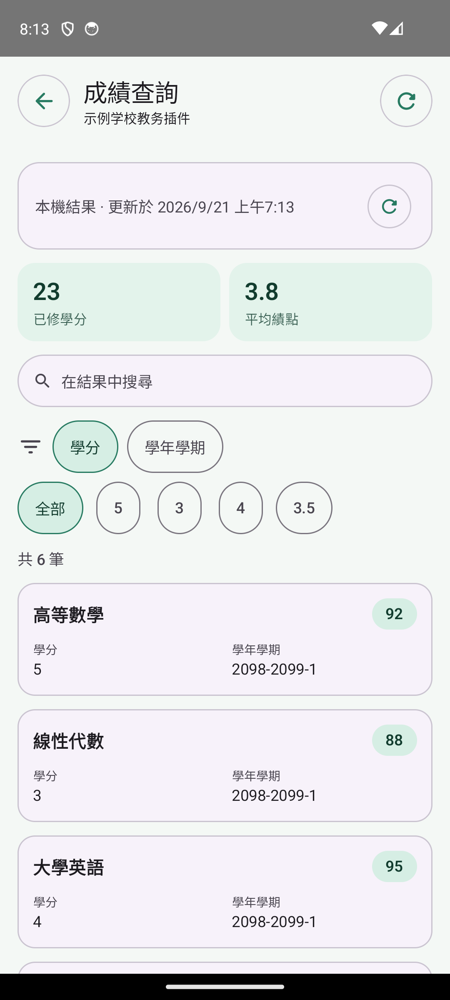
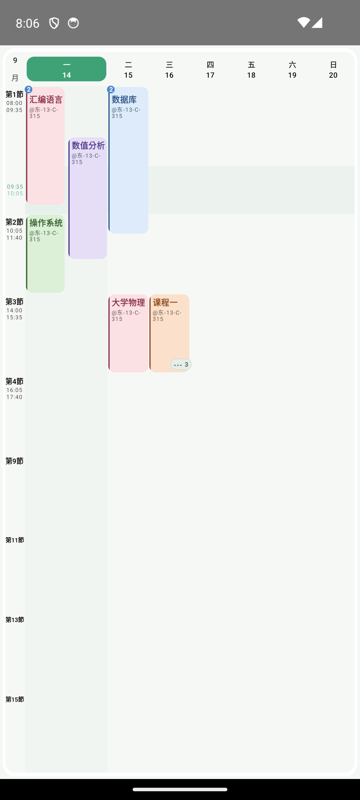
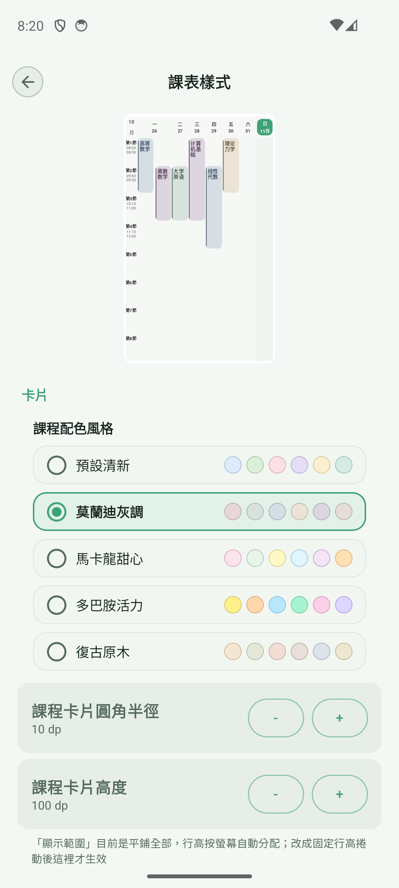
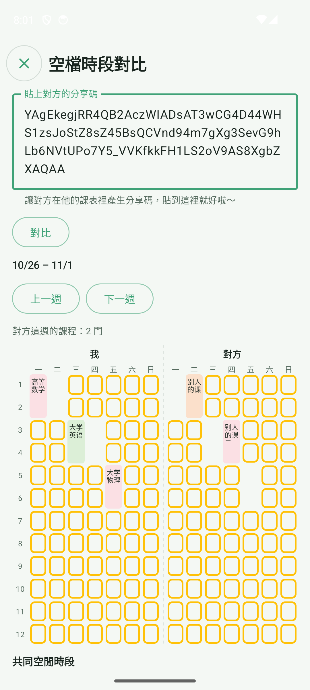
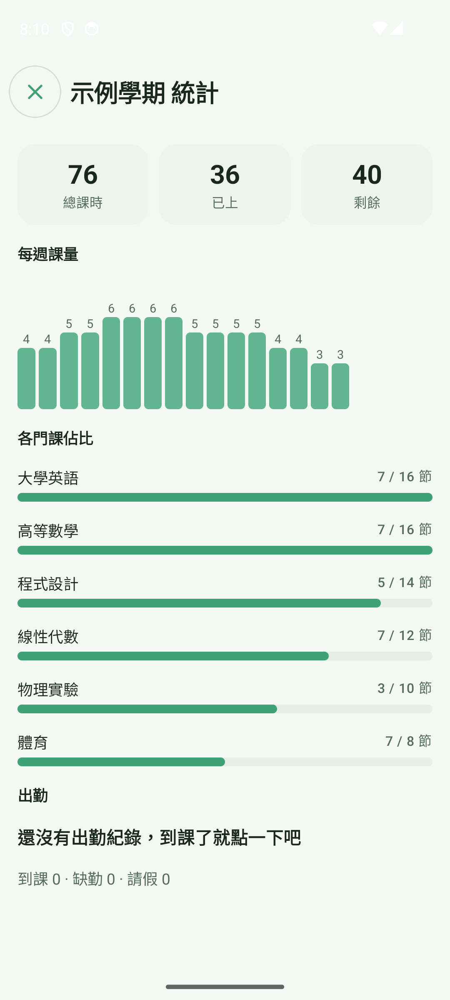
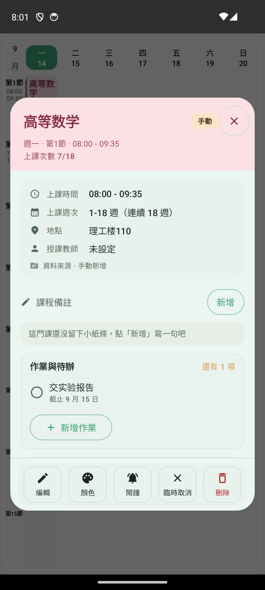
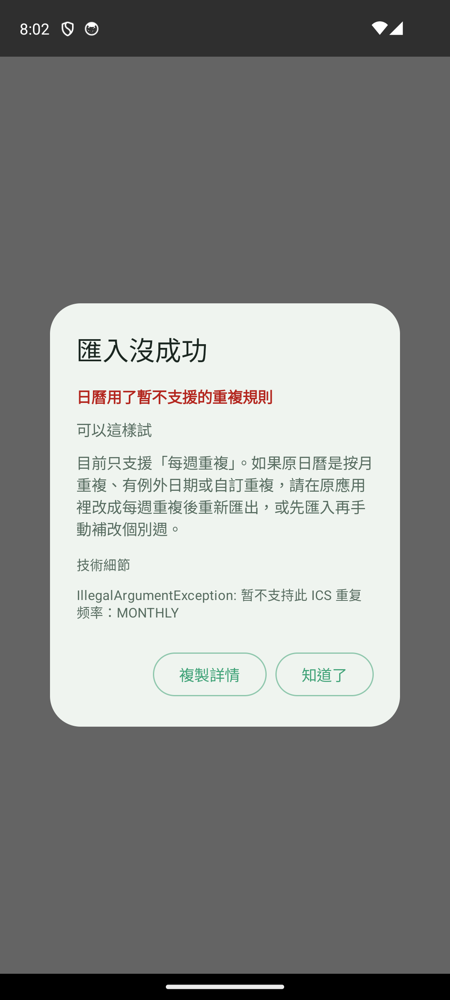

# 0.8.2 · 測試版

0.8.2 彙整了 pre.1 到 pre.3 三輪測試以及之後的全部改動：新增從教務系統匯入課表（收錄 800 多所學校）和外掛主頁；擁擠的日子能並排看清課程，課程和事務可以單獨換色；新增共同空閒時間、學期複製與統計、課程待辦與出席；週課表可以橫滑切週；第三方課表匯入、系統日曆增量同步和小工具也都有改進。在應用程式內開啟「測試版更新」後即可接收本次更新。

## 從教務系統匯入課表：收錄 800 多所學校

- 在「新增」選單裡打開「從教務系統匯入課表」，搜尋你的學校。名單只收錄能從校外直接開啟的教務系統入口。
- 有外掛的學校，右邊是「外掛匯入」，建議優先使用；下方可展開「通用匯入」，外掛出問題時可以改用它。沒有外掛的學校直接是「通用匯入」。搜尋不到的學校，可以輸入教務系統網址（https）直接開啟。
- 通用匯入：登入並進入課表頁面後，點「上傳課表」才會讀取頁面，不會自動擷取。辨識不了時會一直顯示原因（找不到課表、找到課表結構但沒辨識出課程，或有 N 門課讀不出週次、節次）。只要有一門課讀不出來，整張課表都不會匯入，不會留下殘缺資料。
- 相容常見課表寫法：網格、轉置表、卡片列表、依位置排版的課表，以及單雙週、前八週、後八週、區間等週次和節次寫法。
- 匯入後結果留在匯入頁，並會改用學校自己的作息時間；原來的手動作息表仍保留，可以切回。
- 通用匯入目前只在個別學校實測過，其他學校遇到辨識失敗，歡迎回報。

## 外掛主頁：成績、培養計畫、學分一處查看

- 支援主頁的外掛（如長江大學教務外掛），在外掛頁多一個「外掛主頁」按鈕。點開是選單：上面是帳號卡片，下面是成績查詢、培養計畫、學分進度、學籍資訊。
- 每一項是獨立頁面：彙總數字、搜尋、依欄位篩選，記錄卡片可展開看全部欄位；成績類欄位會做成卡片右上角的標籤。
- 查詢結果依帳號加密快取在本機，只在你手動重新整理時才連線；重新整理失敗時保留上次結果。
- 帳號密碼與匯入課表共用，只加密儲存在本機，可在主頁清除（需二次確認，課表和查詢快取會保留）。
- 重新整理失敗會說明原因：學校的教務系統連不上（可能在維護，是學校官方系統的問題）、手機沒有網路，或登入已過期（帳號密碼已儲存時，只需輸入簡訊驗證碼）。
- 修復了部分教務系統首頁白屏：不再向網頁傳送應用程式套件名稱的請求標頭，教務系統不會再把頁面當成局部重新整理而回傳殘缺內容。

## 擁擠日課表：同一時段也能看清

- 每天最多並排兩列：時間交叉的課左右排開，不交叉的課上下排在同一列。同一節有多門課時，卡片左上角顯示課程數量。
- 同一時段 3 門以上時，保留離「現在」最近的兩門，其餘收進右下角的按鈕。點開可查看全部課程，並顯示時間段、教室、老師，以及「正在上課 / N 分鐘後開始 / 已結束」。
- 平板和橫屏寬度足夠時，每天最多 3 列；放不下時，課最少的日子自動退回單列，卡片不會被壓成一字一行。
- 有摺疊內容的日期表頭顯示小圓點，今天的列加淡色底；窄卡片裡教室號優先在連字號處換行。左側節次列也進一步收窄，給課表更多空間。

## 個人化配色與單課調色

- 新增 5 種預設配色風格：預設清新、莫蘭迪灰調、馬卡龍甜心、多巴胺活力、復古原木。在「設定 → 課表樣式」裡切換，上方的迷你課表會即時預覽。
- 課程和事務都可以自訂填充色、漸層混色和邊框，入口在課程詳情底部的「顏色」按鈕和編輯頁的最下面。

## 週課表橫滑切週

- 課表網格區域支援左右橫滑切換週次，帶平滑的位移和淡入淡出動畫。
- 到達第一週和最後一週時有邊界阻尼，避免誤翻出課表範圍。

## 共同空閒時間

- 在「分享與匯出」裡打開「空檔時段對比」：貼上同學的分享碼，左右兩張真實的週課表並排顯示，中間用虛線隔開。兩人都有空的時段用黃色框圈出。
- 點任意課程塊可以看詳情；下面依天列出共同空閒的節次。左邊是「我」，右邊顯示對方的課表名。
- 資料只在本機計算，不需要伺服器。

## 學期複製、封存與統計

- 學期管理頁可以把已有學期「複製」為新學期，保留課程與時間設定。週次和提醒預設不帶過去，提醒也可以選擇保留。
- 舊學期可以「封存」。封存後仍可回看和統計，不影響目前學期。
- 學期「統計」頁顯示總課時、每週課量、各門課佔比和出席彙總。每週的長條圖直接在長條上方顯示數字，點擊或長按可以看具體課量。

## 課程待辦與出席

- 課程詳情裡有「作業與待辦」：可以直接新增作業，勾選完成前會先確認，並同步到備忘錄。
- 課程可以記錄出席（出席、缺席、請假），預設收起為一行彙總，點開才展開；統計頁自動彙總。
- 課程表單依區塊重新分組，週次選擇獨立成段；事務也用和課程一樣的全螢幕頁編輯。

## 分享、匯入與系統日曆

- 分享碼會帶上作息時間（第一節、午間課等）和課表的來源名稱。匯入時可選「同時使用分享的作息時間」，課程詳情會顯示「來源 · 外掛名稱」。
- 匯入匯出頁新增「第三方匯入」卡片，收納 WakeUp、小愛課表和通用 ICS 匯入。
- 匯入失敗時彈出診斷對話框，說明原因和建議，詳情可以複製。
- 匯出系統日曆時，每個日程都會附加唯一識別碼。再次同步時只做增量更新：自動清理已刪除或調走的課程，更新時間和地點的變化，並寫入新課程。新增一鍵清除已寫入系統日曆的全部日程。

## 小工具、備份與設定

- 備忘錄小工具可以顯示更多條目並支援捲動。
- 小工具新增透明度、模糊和深色適配，並新增課程膠囊小工具。
- WebDAV 支援每週自動備份，自動備份數量超出後清理最舊的一批。
- 設定頁依「顯示」和「樣式」重新分組，分組可以摺疊。新增時間欄寬度設定。
- 側邊欄底部的「換主題」「換背景」會先讓你選類型：主題色或課表樣式，課表背景或小工具背景。
- 管理列表依星期、名稱、來源切換排序時，動畫保持一致。

## 提示語與細節

- 空狀態和占位提示改得更活潑，簡體、繁體、英文都有。
- 修復「明天要上課了」的誤判：以前只看明天是不是假期，現在看明天是否真的有課。
- 沒有設定作息時間時，晚間簡報不再誤報「明天沒有課程」。
- 平板和摺疊螢幕使用雙欄佈局，並新增即時時間線、晚間簡報、換教室和考試提醒（考試提醒預設關閉）。
- 開發者頁面新增「鬧鐘測試」，點一下約 2 秒後響一次，用來檢查鬧鐘是否正常；外掛日誌的篩選按鈕不再被擠成直排。

## 修復與穩定性

- 修復橫屏下的當機，以及橫屏無法捲動的問題。
- 加固匯入、下載、檔案提供者、備份規則和外掛套件解析，限制檔案大小與權限；更新了相依套件。
- 考場卡片中的座位號和證件提示，在英文和繁體環境下改為對應語言。
- 小愛課表匯入失敗的提示和擴充元件的到期提醒日期，改為跟隨應用程式語言顯示。
