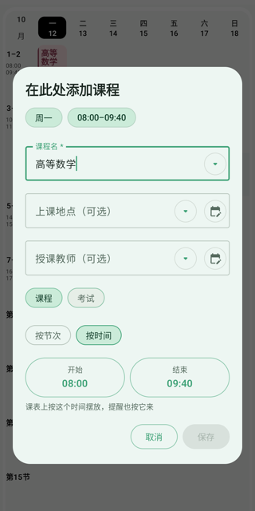
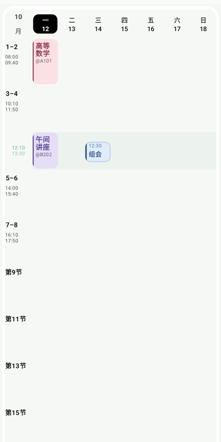
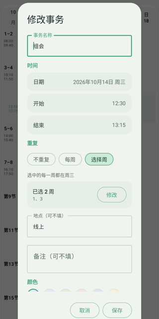
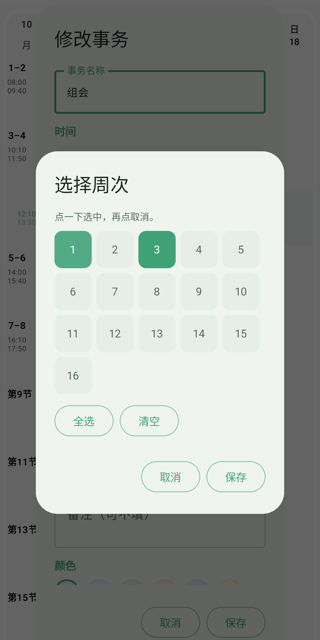
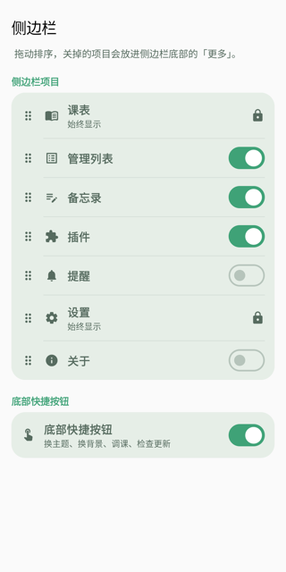
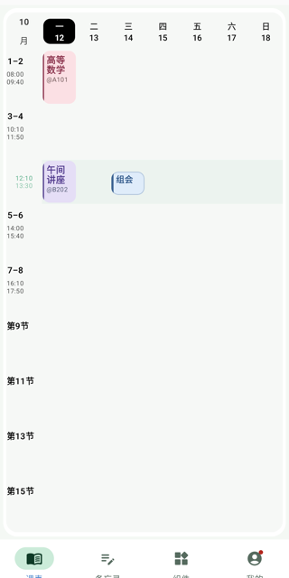
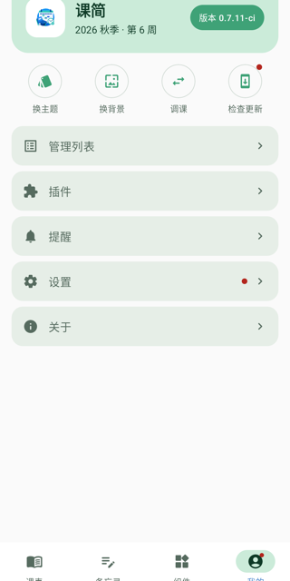

# 0.7.11 · 测试版

本次在 0.7.10 基础上新增按时间录入课程、事务按周选择、侧边栏自定义与底栏布局，并重新整理了小组件和管理列表。应用内开启「测试版更新」后可接收本次更新。

## 课程可以直接填时间

加课、快速加课和编辑课程时，可以在「按节次」和「按时间」之间切换。选「按时间」后用时间选择器填入开始与结束时间，课表按这个时间摆放课程卡片，单课提醒、首课提醒、课前静音、课程详情、导出日历和桌面小组件也都改用这个时间。

不在标准节次上的课不会再被压回整节。例如 12:10–13:30 的午间课，会插在 3–4 节和 5–6 节之间单独占一条，左侧标出真实时间。

按时间摆放的课程不能拖动调整，要改时间请打开编辑表单。

## 事务按周挑着重复

事务的重复方式由「每周」一个开关改成「不重复 / 每周 / 选择周」。选「选择周」后可以在周次格子里点选任意几周，事务固定落在当天对应的星期几；详情和列表会显示「共 2 周：10/14、10/28」。

## 侧边栏自己排

设置里新增「侧边栏」：项目可以拖动排序，也可以逐个关掉。关掉的项不会消失，会收进侧边栏底部的「更多」，照常能进。课表和设置固定显示，底部四个快捷按钮也能整组关掉。侧边栏里的组件最多显示 3 个，更多的进「查看全部」。

## 常用页面放底栏

安装「布局」组件后，可以把导航从侧边栏换成底栏，默认是「课表 · 笔记 · 组件 · 我的」。课表固定在第一个，「我的」固定在最后，中间最多放 3 个。没放进底栏的页面和四个快捷按钮都收在「我的」里，更新红点也合并到这上面。随时可以在组件设置里或「设置 → 侧边栏」里换回侧边栏；组件停用或删除时会自动回到侧边栏。

## 今日安排收录事务

「每日课程」小组件改名为「今日安排」，事务和课程按时间排在同一列，事务带「事务」标签，进行中还会标出来。课简日历小组件会标出有事务的日子。设置 → 桌面小组件新增「在小组件上显示事务」，默认开启。

## 管理列表重新整理

管理列表顶部可以切换「课程 / 事务」，右下角的按钮跟着当前页变化。卡片改成一屏能看更多，编辑、还原和删除收进「⋮」菜单，插件课程也能修改的提示只显示一次。已删除的课程可以「彻底删除」，删掉后不再恢复，下次同步也不会被加回课表。

## 更多改进

- 今日概览的上下课倒计时精确到秒，数字等宽不会抖动；其他内容改为整分钟刷新。
- 桌面待办先进入只读详情，点铅笔才编辑；浮窗高度固定，切换面板时不再跳动。
- 笔记一次可以插入多张图片，按选择顺序排列，一次撤销即可全部撤回；工具栏图标长按显示名称。
- 地点前是否加「@」可以在设置里切换，默认加；地点略长时自动缩小字号，不再截掉最后一个字。
- 设置子页的标题与返回移到应用顶栏，学期管理、导入导出等页面开合带过渡。
- 「今日安排」和课程日历小组件都能进入对应日期的课表。

## 修复与稳定性

- 关闭桌面浮窗（待办编辑、课程详情）时不再闪一下、滑一下或缩放。
- 应用启动不再重绘所有桌面小组件，减少卡片闪烁；只有时区、笔记等真的变化时才刷新。
- 小组件会在事务开始前、开始时和结束时自动更新状态。
- 加课和编辑时，教师、地点输入框不再一打字就弹出下拉；点输入框只移动光标，点箭头才列出已保存的值。
- 切换语言后，笔记分享与导入的文案会跟着变。

## 组件能力

- 组件接口升到 12：组件可以声明自己提供的布局，由课简原生绘制；组件页也能查询和切换当前布局，不合规的请求会给出提示且不改动现状。11 及以下的组件照常可用。
- 协议细节整理进仓库里的 `docs/plugin-system.md`，补齐了 10、11 两版能力说明。

## 配套组件与插件

- 「布局」组件 v1.0.0：把导航换成底栏，可选择底栏放哪些页面，需要课简 0.7.11 以上。
- 雨课堂通知组件 v1.3.8、多平台通知组件 v1.2.8 已独立发布，可另行安装。
