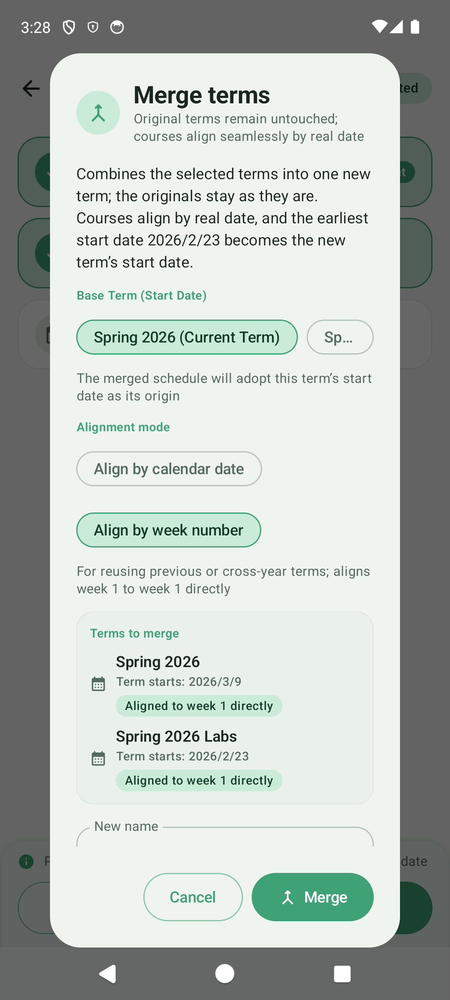
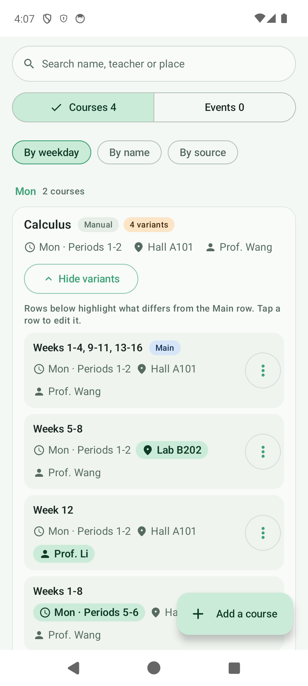
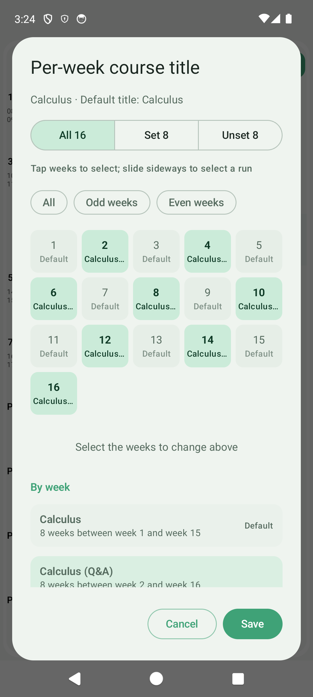
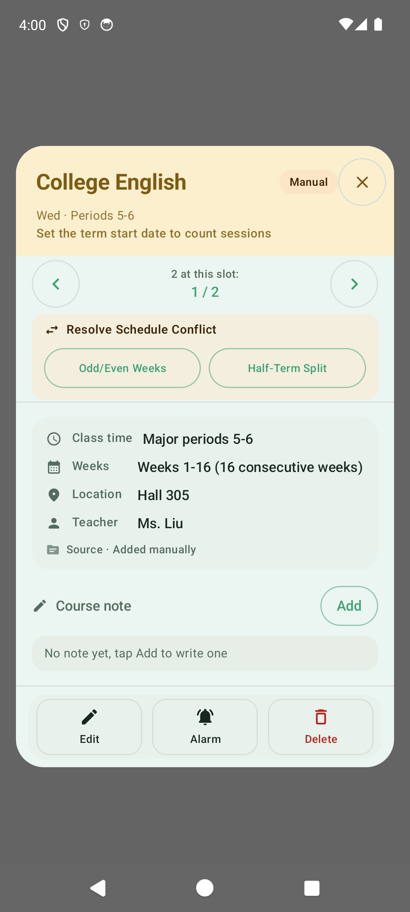
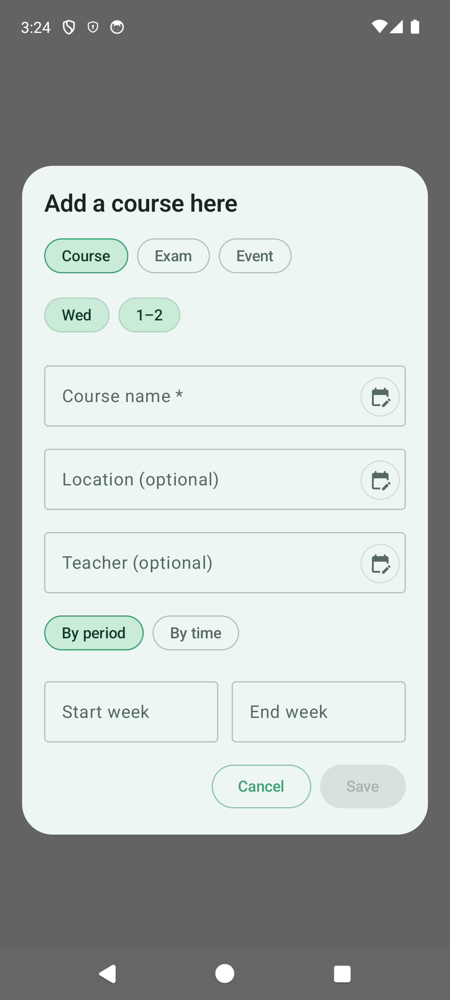
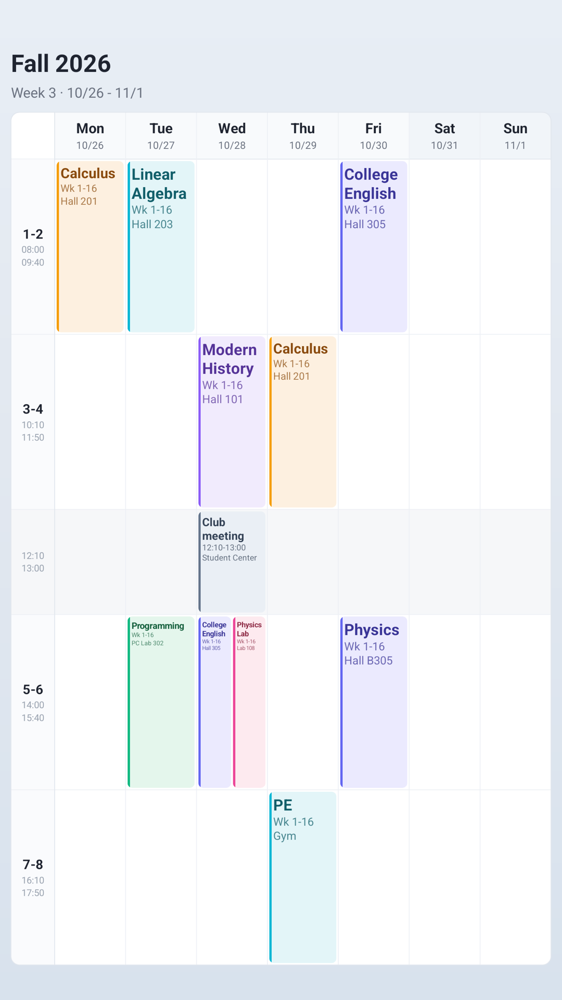
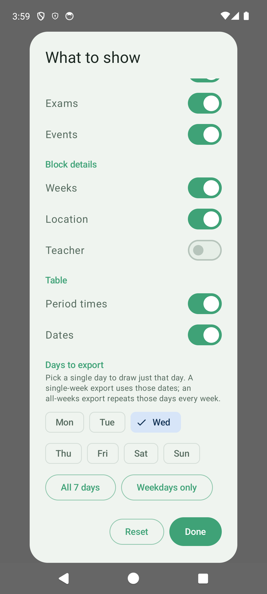

# 0.8.0 · Beta

0.8.0 is a big update. You can merge several terms into one, see every arrangement of a course in the library, set course titles, teachers, and locations by week, and split conflicting courses with one tap. The 9:16 lock-screen wallpaper now truly fills the screen, and you choose what the image shows and which days it covers. Events are now saved per term, and the today overview, class reminders, and settings all got improvements. Turn on beta updates in the app to receive it.

## Merge terms: minors, campuses, and past years in one timetable

Term management has a new "Merge Timetables" card. Pick two or more terms and their courses are aligned into one new, separate term. The original terms and their data stay untouched, so deleting the merged term puts everything back.

- **Two ways to align**: "Align by calendar date" suits a major plus a minor or lab courses in the same term, shifting weeks by the gap between start dates. "Align by week number" maps week 1 to week 1, which suits reusing a past or cross-year timetable.
- **See the result first**: each term is labeled as the base week, shifted +N weeks, a past term (-N weeks), or cross-year, and you can choose whose start date the new term uses.
- **Warnings for odd cases**: if a past term is detected or the start dates are far apart, the app suggests "Align by week number" so courses don't land on negative or far-off weeks.
- Merged courses show a "Source term" row in their details.

## Course library: every arrangement of a course at a glance

When a course moves to another room, gets another teacher, or changes its name for some weeks, or meets several times a week, the library folds it into one card labeled "N variants".

- Tap "Show variants" to list each arrangement on its own row: which weeks, when, where, and who teaches.
- The first row is marked "Main". On the other rows, whatever differs from it is highlighted, such as weeks 5–8 in the lab building or a different teacher in week 12.
- Tap a row to edit it. Move, Alarm, and Delete live in each row's menu.
- Search also finds per-week locations, teachers, and titles.

## Course titles, teachers, and locations by week

Course titles can now be set per week, too. While editing a course, tap the calendar icon next to the title to open "Per-week course title" and give some weeks a different name. Once set, the icon is highlighted and reads "N week(s) use a custom title".

Setting titles, teachers, or locations by week now works the same way everywhere: pick the weeks, then enter the value.

- Filter the week grid by "All / Set / Unset". Each cell shows that week's current value.
- Tap weeks one by one or swipe across to select a run. "All / Odd weeks / Even weeks / Clear" only affect the weeks currently shown.
- "By week" below groups the weeks by value; tap a group to select those weeks.
- If the selected weeks hold different values, you'll see "These weeks differ; type to set them all". Changed your mind? Tap "Use default".

## Resolve schedule conflicts in one tap

When two courses overlap in weeks and periods, course details show "Resolve Schedule Conflict":

- **Odd/Even Weeks**: this course takes the odd weeks and the other takes the even weeks.
- **Half-Term Split**: the two courses split at the midpoint of their weeks, one before and one after.

One tap saves both courses, with no week editing by hand.

## Courses, exams, and events from one place

Adding a course, or quick-adding from an empty spot on the timetable, now starts with a "Course / Exam / Event" switch. "Exam" adds an exam. "Event" switches to the event form with date, start and end time, location, notes, repeat, and color.

Adding an event from a spot on the timetable fills in that spot's date and periods.

## Events belong to their term

Events are now saved per term. Switch terms and the events on the timetable switch with them, so last term's events no longer show up. Existing events move to the current term on first launch and nothing is lost.

## Schedule images: a full-screen wallpaper, with the content and days you choose

- **A 9:16 wallpaper that fills the screen**: choose "Wallpaper (9:16)" and the timetable is laid out again for a portrait screen. It runs from below the status bar down to just above the gesture bar, with larger text and full course names, ready to set as your lock screen.
- **Choose what the image shows**: the settings button at the top right of the export dialog turns courses, exams, and events on or off, along with weeks, location, teacher, period times, and dates. By default only course names and weeks are shown; turn on events, locations, and teachers when you want them. Your choices are remembered for the next export.
- **Choose which days**: pick any of Monday to Sunday. Export a single day, or weekdays only. With "One week" you get those days of that week; with "All weeks" you get those days as they repeat every week. Days without classes still keep their column.
- **Events at their real time**: with events on, each event sits in its class period, and events outside class hours get a row of their own.
- **Save to device**: on Android 10 and newer, images go to Pictures/CurSimple; older versions use the system's create-file picker. File names include the term, week, and a wallpaper tag, so they're easy to find.
- Open the preview full screen and pinch to zoom before you share or save.

## Today overview

- On make-up days you'll see "Make-up day: Schedule for X applies today" instead of a schedule based on the weekday alone.
- New "Free Slots & Study Windows" lists your free time by morning, afternoon, and evening, with the matching periods.

## Class reminders

- Turning on "Class reminders" asks for notification permission right away.
- Before a preview, the app checks permissions. Without permission it shows the system prompt; if notifications are blocked or the overlay permission is missing, it explains why and opens the right settings page.
- If the system lowers the banner and the preview only reaches the notification shade, you'll see "No banner?" with a shortcut to fix it.
- Reminder titles use this week's course title, matching the timetable.

## More improvements

- Settings sub-pages slide in and out. Cards, switch rows, and dividers share one color scheme, and every row you can open has an arrow.
- The bottom bar layout lets you pick a button size (small / medium / large).
- When the timetable or events don't fit on one screen, or course names would be squeezed into a single-character column, the timetable scrolls vertically and a short notice appears at the top. Remove the extra courses or events and it fits one page again; "Vertical layout" in settings shows when scrolling is temporary. When a busy day widens, the other days keep room for at least two characters.
- The "Today" widget has a new button that jumps back to today.
- The system calendar export panel is laid out again: accounts show a color dot and a check mark, exports show progress, and "Undo" appears only when there is something to undo.
- Empty states in notes and the course library are now centered cards with shorter text. Checking items, switching tabs, and picking weeks give haptic feedback.
- In the course library's "Courses" tab, the add button can also add an event and switches to the "Events" tab.
- Downloads and plugin installs have more backup mirrors, so they connect more often on weak networks.

## Cloud sync

WebDAV no longer fills in any provider address. The address field starts empty; enter the folder address from your own cloud storage provider.

## Fixes

- After merging terms, course details, the timetable, and reminders all read the same per-week titles.
- The system calendar export and "Undo last write" check their state more accurately.
- With the system's Reduce Motion setting on, the class reminder switch and settings page transitions no longer animate.
- Status messages on the timetable follow the app's language setting instead of the system language.
